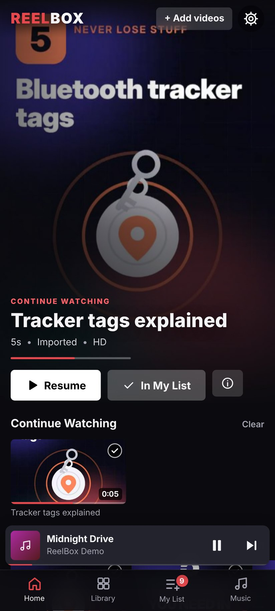
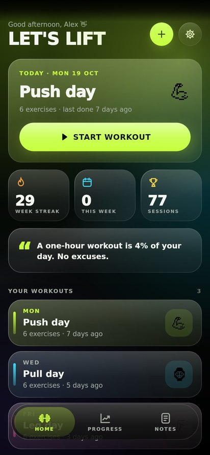
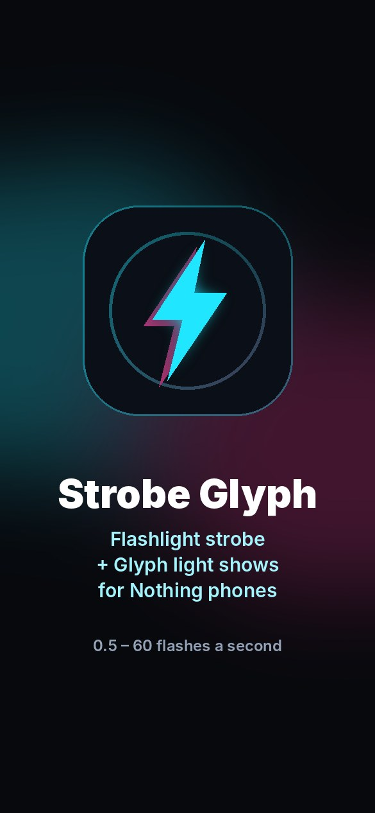

<h1 align="center">Unknown Projects</h1>

<b>Loads of stuff I've made.</b> Free Android apps and games: no ads, no accounts, and nothing uploaded.

  
  
  

| 🎬 [ReelBox](reelbox.md) | 🇪🇸 [Adjetivos](adjetivos/) | 🏋️ [IronLog](ironlog/) | 🔦 [Strobe Glyph](strobe-glyph/) | ✍️ [Sketchnote](sketchnote/) |
|:---:|:---:|:---:|:---:|:---:|
|  |  |  |  |  |
| Your phone's videos and music, streaming-app style. *Continue Watching*, playlists from your folders and lock-screen controls. | Learn Spanish describing words with 19 mini games: bubble pop, word ninja, whack-a-word and more. | A gym tracker with a tinted black-glass look. Last time's weights filled in, a graph for every lift and PR celebrations. | A fast, controllable flashlight strobe, with light shows for the Glyph lights on Nothing phones. ⚠️ Flashing lights. | Endless paper for sketches and notes: pressure-sensitive pens, sticky notes, shapes, photo markup and palm rejection. |
| [⬇ ReelBox.apk](../../releases/latest/download/ReelBox.apk) | [▶ Play in browser](https://olrock8910.github.io/Unknown-projects/adjetivos/) · [⬇ Adjetivos.apk](https://github.com/OlRock8910/Unknown-projects/raw/main/adjetivos/apk/Adjetivos.apk) | [⬇ IronLog.apk](https://github.com/OlRock8910/Unknown-projects/releases/download/ironlog-latest/IronLog.apk) | [⬇ StrobeGlyph.apk](https://github.com/OlRock8910/Unknown-projects/raw/main/strobe-glyph/apk/StrobeGlyph.apk) | [⬇ Sketchnote.apk](https://github.com/OlRock8910/Unknown-projects/raw/main/sketchnote/apk/Sketchnote.apk) |
| [More about ReelBox →](reelbox.md) | [More about Adjetivos →](adjetivos/) | [More about IronLog →](ironlog/) | [More about Strobe Glyph →](strobe-glyph/) | [More about Sketchnote →](sketchnote/) |

## Installing an app

1. On your Android phone, tap the **⬇ .apk** link for the app you want.
2. Open the download. If Android asks, allow installing from your browser or Files app.
3. New versions install over old ones and keep your data.

## What's where

| Folder | Project | Built with |
|---|---|---|
| `src/`, `android/`, `tests/` | ReelBox | TypeScript + Vite, wrapped with Capacitor |
| `adjetivos/` | Adjetivos | Web games, also built as an Android app |
| `ironlog/` | IronLog | Kotlin + Jetpack Compose |
| `strobe-glyph/` | Strobe Glyph | Java, native Android |
| `sketchnote/` | Sketchnote | Java, native Android |

Each project has its own build workflow in `.github/workflows/`, and every change
publishes a fresh APK.

## License

[MIT](LICENSE). Each project's page has details.
