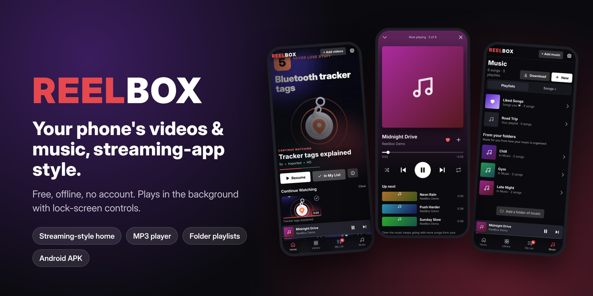
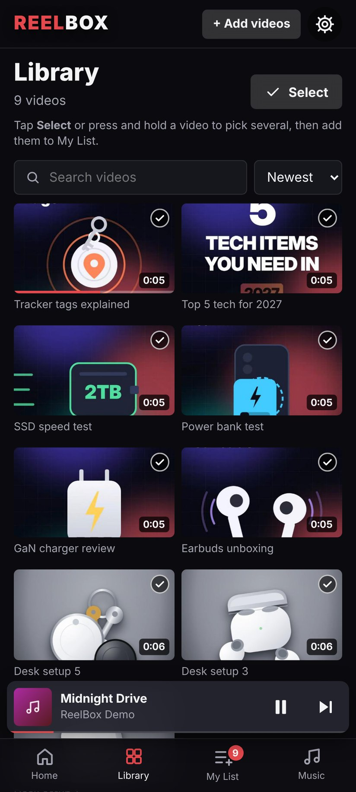
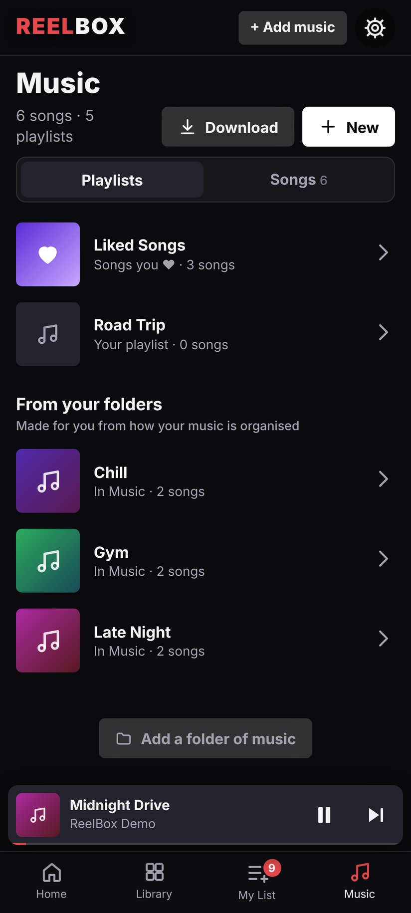
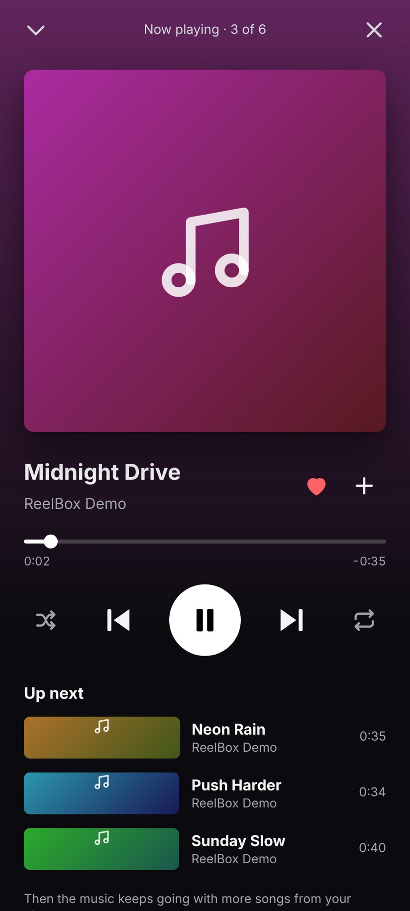
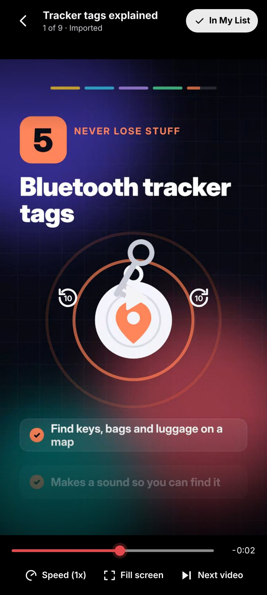
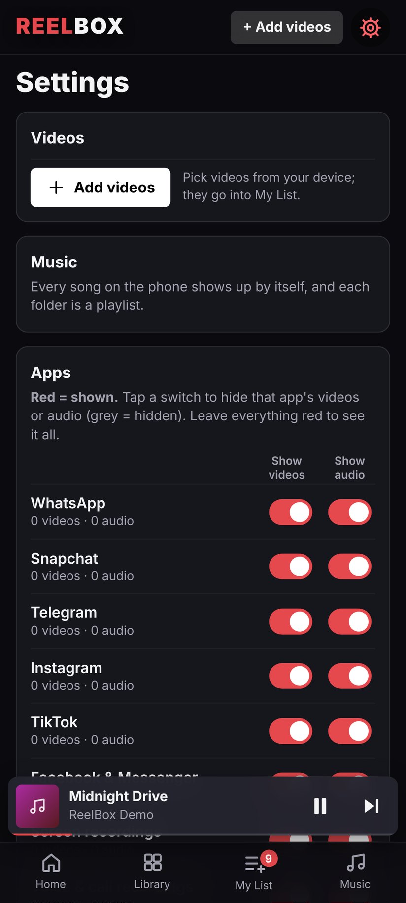

<p align="center">
  
</p>

<p align="center">
  <a href="../../releases/latest/download/ReelBox.apk"></a>
  
  
</p>

> 🇪🇸 **Also in this repo: [Adjetivos](adjetivos/)** — learn Spanish describing words with 19 mini games.
> [▶ Play it in your browser](https://olrock8910.github.io/Unknown-projects/adjetivos/) · [⬇ Android app](https://github.com/OlRock8910/Unknown-projects/raw/main/adjetivos/apk/Adjetivos.apk)
>
> 🏋️ **Also in this repo: [IronLog](ironlog/)**: a gym tracker with a tinted black-glass look, graphs for every lift and PR celebrations.
> [⬇ Android app](https://github.com/OlRock8910/Unknown-projects/releases/download/ironlog-latest/IronLog.apk)

**ReelBox turns the videos and songs already on your phone into a streaming-style app.** It has a big featured video, rows to scroll, *Continue Watching*, a proper MP3 player with playlists, and lock-screen controls. It's free, works offline, needs no account and uploads nothing.

## Screenshots

| Home | Library | Music |
|:---:|:---:|:---:|
|  |  |  |
| **Now Playing** | **Player** | **Settings** |
|  |  |  |

## What it does

**Videos**
- 🎬 **Streaming-style home** built from your gallery: *Continue Watching*, *My List*, *Recently Added* and a row for every album.
- ➕ **My List**: pick the videos you want to watch, one by one or with **Select all**, and they wait for you there.
- ⏯️ **Picks up where you left off.** Your place is saved every few seconds.
- 👆 Double-tap to skip 10 s, change speed, fill or fit the screen, and *Up next* auto-play.

**Music**
- 🎵 **Every song on your phone** (MP3, M4A, FLAC…) with search, shuffle and repeat.
- 📁 **Your folders become playlists.** Keep `Songs/Chill` and `Songs/Gym` and you get *Chill* and *Gym*, in track order. Rename them in the app if the folder names are messy.
- ❤️ **Liked Songs** and **as many playlists as you like.**
- ♾️ The music never just stops. When a list ends, it carries on with more of your songs.
- ⬇️ **Download from a link**, or **Share → Save to ReelBox** from Files, WhatsApp, Telegram or your browser.

**Everywhere**
- 🔒 **Plays in the background and on the lock screen**, with play/pause/skip and a ♥ in the notification.
- 🤝 **Plays nicely with other apps.** It pauses when another app plays sound and resumes after calls and voice notes.
- 🙈 **Hide things**: single videos or songs, whole folders, or everything from WhatsApp, Snapchat, Telegram and other apps.
- 🧹 **Duplicates hidden automatically**, and one-tap **Clear all** with **Undo**.

## Install

1. On your Android phone, tap **[Download ReelBox.apk](../../releases/latest/download/ReelBox.apk)**.
2. Open the download. If Android asks, allow installing from your browser or Files app.
3. Open ReelBox and tap **Allow access** so it can see your videos and music.

New versions install over old ones; your lists and playlists stay.

> Not on Android? `npm install && npm run dev` runs the same app in a browser, where you add videos and music by picking files or folders.

## Privacy

ReelBox reads your gallery **on your phone** and keeps your lists, playlists and progress **on your phone**. It has no account, no analytics, no ads and no servers. The internet is only used when you paste a download link.

## Build it yourself

You need Node 22, JDK 21 and the Android SDK (compileSdk 34).

```bash
npm install
npm run build && node tests/smoke.mjs      # the browser test
npm run android:sync
cd android && ./gradlew assembleRelease    # → app/build/outputs/apk/release/app-release.apk
```

Every push to `main` runs the tests, builds the APK and publishes it to [Releases](../../releases). Builds are signed with the committed sideload key (`android/app/reelbox-sideload.jks`, password public on purpose) so each new APK upgrades the last one. For a Play Store release you would use your own private key.

## How it's built

A web app (TypeScript + Vite, no framework) wrapped for Android with Capacitor, plus a small native layer:

```
src/
├── app.ts             Screens, routing, selection, settings
├── player.ts          The full-screen video player
├── music.ts           The music player: queue, shuffle/repeat, mini player, Now Playing
├── media.ts           Routes lock-screen buttons to whichever player is active
├── dedupe.ts          Spots copies of the same video or song
├── filters.ts         Which folders belong to WhatsApp, Snapchat… for Settings
├── store.ts           Lists, playlists, likes and progress (on the device)
└── sources/           Android gallery access, or picked files in a browser
android/app/src/main/java/com/reelbox/app/
├── GalleryPlugin.java         MediaStore listing, permissions, picker, share target
├── MediaWebViewClient.java    Streams /_media/… to the WebView with byte ranges
├── MediaPlaybackService.java  Foreground service, MediaSession, audio focus
└── SongSaver.java             Saves downloaded and shared songs
```

- Video and audio are streamed straight from MediaStore to the WebView, not copied or passed through the JS bridge.
- Android's WebView pauses hidden videos, but never audio-only playback. So when you leave the app mid-video, the sound moves to a hidden `<audio>` element and back when you return.
- A foreground service with a MediaSession keeps playback alive with the screen off and owns the lock-screen controls and audio focus.

## Contributing

Issues and pull requests are welcome. If you're adding a feature, please run `node tests/smoke.mjs` before opening the PR.

## License

[MIT](LICENSE). The demo clips and music in the screenshots are original and made for this project.
