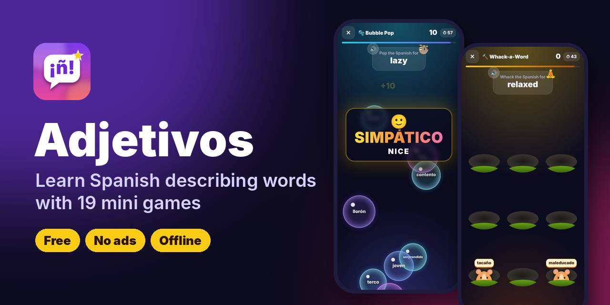
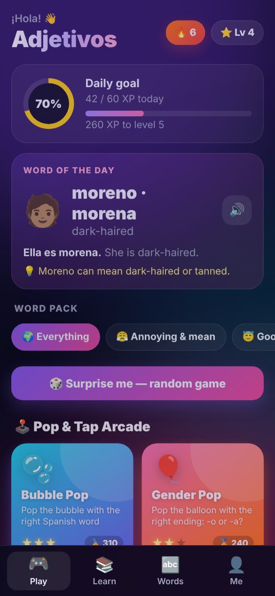
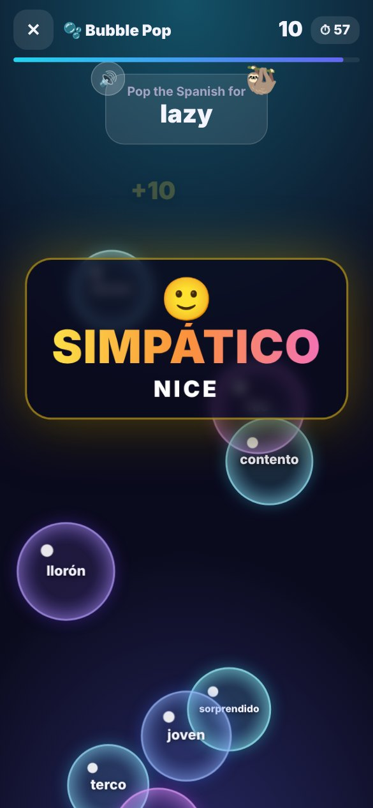
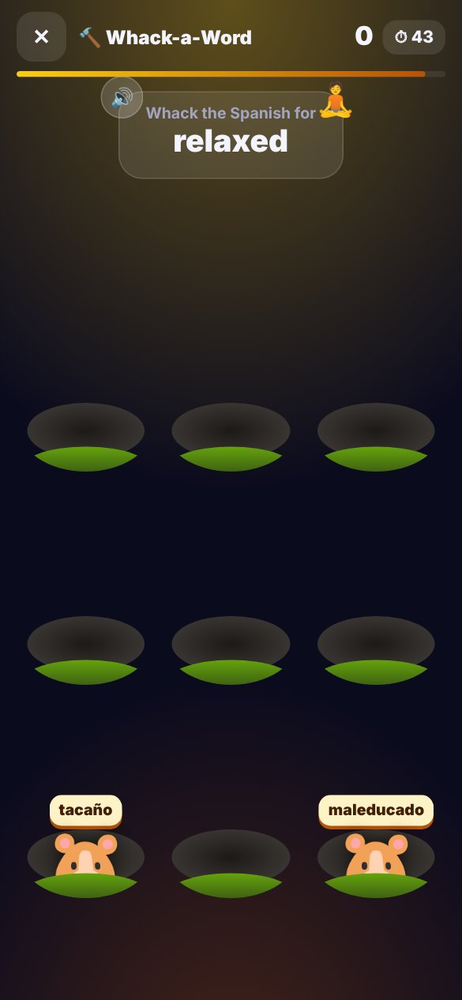
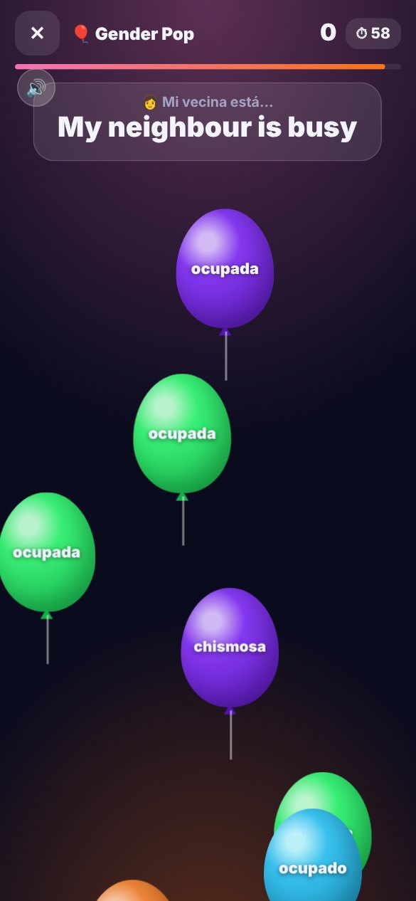
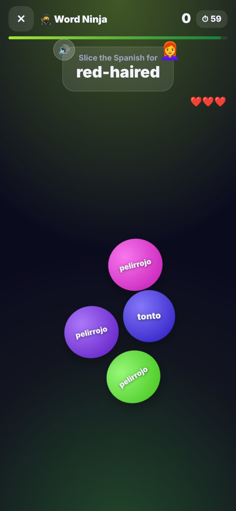
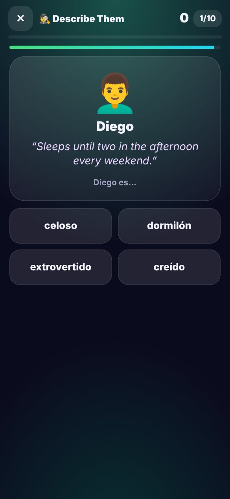
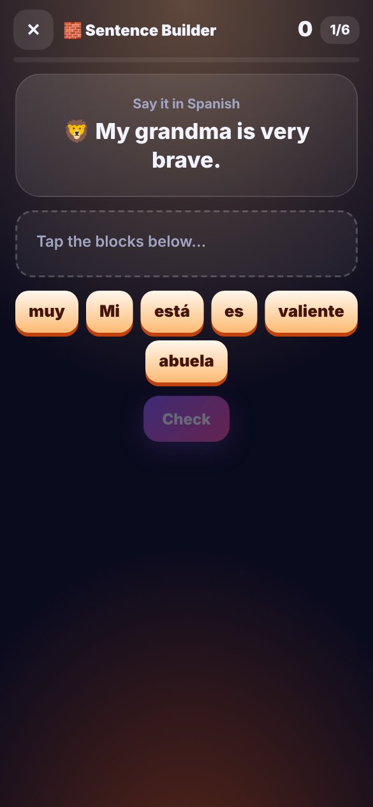
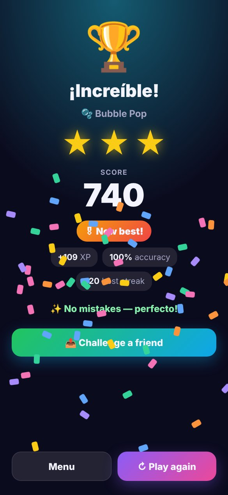

<p align="center">
  
</p>

<p align="center">
  <a href="https://olrock8910.github.io/Unknown-projects/adjetivos/"></a>
  <a href="https://github.com/OlRock8910/Unknown-projects/raw/main/adjetivos/apk/Adjetivos.apk"></a>
  
</p>

# Adjetivos 🇪🇸

**Learn Spanish describing words by popping bubbles, slicing words and
whacking moles.** *Mi hermano es muy molesto* 😤 — 96 adjectives, 19 mini
games, a real Spanish voice, and no ads or accounts.

| **Home** | **Bubble Pop** — right answers flash up big | **Whack-a-Word** | **Gender Pop** |
|:---:|:---:|:---:|:---:|
|  |  |  |  |
| **Word Ninja** | **Describe Them** | **Sentence Builder** | **Beat your best** |
|  |  |  |  |

### ▶ Play it right now

Open **https://olrock8910.github.io/Unknown-projects/adjetivos/** on any phone or
computer. Nothing to install. On a phone, use your browser's
**Add to Home screen** to keep it like an app.

## Install the Android app

1. On the phone, tap the green **Download Adjetivos.apk** button at the top of
   this page (or open [`apk/Adjetivos.apk`](apk/Adjetivos.apk) and tap **Download**).
2. Open the downloaded file. If Android asks, allow your browser or file
   manager to **install unknown apps**.
3. Tap **Install**, then open **Adjetivos**.

Everything works offline except **Play online**, which needs internet on both phones.

### The voice

Words and sentences are spoken by **Google's text-to-speech voices**, the same
ones Google Translate uses, built into most Android phones as "Speech
Services by Google". The app always asks for Google's engine, even if the
phone defaults to another one (Samsung's, for example), and picks its best
Spain-Spanish voice.

- If the Spanish voice pack isn't downloaded yet, the home screen shows
  **Get the Google voice**. Tap it, download Spanish, and come back.
- **Me › Spanish voice** lists every Spanish voice on the phone (Spain,
  Mexico, US…). Tap one to hear it and switch to it.
- No Google engine at all? The same button opens "Speech Services by Google"
  on the Play Store.

Each task **says the Spanish word slowly** as it appears (in Bubble Pop,
for example, it says *torpe* while showing "clumsy"). Tap **🔊** to hear it
again, or **Hear it again** after answering. Questions where you have to
pick the Spanish word yourself stay silent until you answer, so the voice
doesn't give the answer away.

## What's inside

**96 adjectives** in four packs: 😤 Annoying & mean, 😇 Good traits,
👀 Looks, 💭 Feelings. Each one has its feminine form, an emoji, an opposite
where there is one, ser/estar, and tips for false friends (*sensible* means
*sensitive*, *embarazada* means *pregnant*).

**19 mini games**

| | Game | How it plays |
| --- | --- | --- |
| 🫧 | Bubble Pop | Bubbles float up — pop the Spanish word for the English one |
| 🎈 | Gender Pop | "She is lazy" — pop *perezosa*, not *perezoso* |
| ☔ | Word Rain | Meanings fall; catch the right one before it lands. 3 lives |
| 🥷 | Word Ninja | Words fly up — swipe to slice the right one, avoid the rest |
| 🔨 | Whack-a-Word | Bonk the mole holding the right word |
| 🃏 | Memory Match | Flip cards to pair Spanish with English |
| ⚡ | True or False | 60-second blitz; swipe or tap |
| ❓ | Quick Quiz | 10 mixed questions: words, sentences, fill the gap |
| 🔥 | Survival | Endless questions with less time each round, 3 lives |
| 🔗 | Match Up | Connect five pairs as fast as you can, three rounds |
| ☯️ | Opposites | *alto* ↔ *bajo*, *valiente* ↔ *cobarde* |
| 😜 | Emoji Guess | Which adjective is the emoji? |
| 🎧 | Listen Up | Hear a sentence, pick what the person is like |
| 🕵️ | Describe Them | "Never stops talking" → *Lucía es habladora* |
| 🔤 | Word Scramble | Unscramble the letters, in the right gender |
| 🎈 | Save the Balloons | Hangman — each wrong letter pops a balloon |
| 🧱 | Sentence Builder | Build "Mi hermana es muy generosa" from blocks |
| 👫 | ¿Él o Ella? | Is the form for him, her, or both? |
| ⚖️ | ¿Ser o Estar? | *es* or *está*, including words that change meaning |

Every right answer flashes the word big in the middle of the screen,
Spanish over English (**AMABLE · KIND**), and says it out loud.

**👥 Play with friends**

- **Play online** — open the **👥 Friends** tab (or the big *Play with
  friends* button on the home screen) and your phone shows a 5-letter code.
  Send it to a friend; they type it into their Friends tab and the game
  starts on both phones. Both see the same word at the same time and the
  faster right tap wins the point (each phone times its own tap, so a slow
  connection doesn't cost you). First to 7 wins, then rematch. It uses
  [PeerJS](https://peerjs.com): their free server only introduces the two
  phones, which then talk directly. Nothing is stored and no account is
  needed.
- **Duel on one phone** — put the phone flat between two players; each gets
  half the screen. First to tap the right Spanish word wins the point, first
  to 7 wins.
- **Challenge codes** — after any game, **📤 Challenge a friend** sends your
  score, a code like `QUIZ-4F7K2-230` and a link to the app through WhatsApp,
  Snapchat or anything else. Your friend types the code into
  **👥 Play with friends**, plays the same game with the same words, and sees
  who won — then sends their score back the same way. No accounts or
  internet needed.

**☁️ Optional sign-in** — on the **Me** tab, type your email, get a 6-digit
code, and your XP, stars, scores and learned words are saved to your account
and follow you to any phone. Playing on two phones merges the best of both.
It needs a free Supabase project — see [docs/SIGN-IN.md](docs/SIGN-IN.md);
until one is set up, the app works without accounts exactly as before.

Also: flashcards, eight short grammar lessons, a searchable word list with
pronunciation, XP and levels, a daily goal and streak, combo multipliers,
stars and best scores. Words you get wrong come up more often.

## How it's built

```
web/            The whole app: plain HTML, CSS and JavaScript, no build step
  js/data.js      Every adjective, the packs, sentence parts, grammar tips
  js/core.js      Saving, sound effects, speech, the game session and scoring
  js/games.js     The 19 mini games
  js/app.js       Screens and navigation
  js/online.js    Online duels between two phones (PeerJS, in js/vendor/)
  js/account.js   Optional sign-in with an emailed code, and saving progress to it
  js/config.js    The Supabase project sign-in uses (empty = sign-in off)
android/        A WebView wrapper that adds Spanish text-to-speech and vibration
build-apk.sh    Builds and signs the APK without Gradle
tests/smoke.mjs Plays every game in a real browser and fails on any error
tests/online.mjs Plays an online match between two browsers through a local PeerJS server
tests/account.mjs Signs in on two browsers against a stand-in for Supabase
```

Open `web/index.html` in a desktop browser to play without building anything.

### Building the APK

```bash
sudo apt-get install aapt dalvik-exchange zipalign apksigner android-sdk-platform-23 default-jdk-headless zip
./build-apk.sh                 # → build/Adjetivos.apk
cp build/Adjetivos.apk apk/    # update the downloadable copy
```

Two GitHub Actions workflows at the root of the repository look after this
folder: `adjetivos.yml` plays every game in a browser and builds the APK
(uploaded as the `adjetivos-apk` artifact) whenever `adjetivos/` changes,
and `adjetivos-pages.yml` publishes `web/` as the play-in-your-browser
website.

`promo/screenshots.mjs` retakes the screenshots above from the real app,
and `promo/og-image.py` rebuilds the banner, which is also the picture shown
when the link is posted on social media.

### Signing

Every build is signed with `android/adjetivos-sideload.jks`, which is
committed on purpose and whose password (`adjetivos`) is public. Every build
then has the same signature, so new versions install over old ones and keep
your progress. It is only for sideloading — publishing to the Play Store
would need a private key.

## License

MIT, like the rest of this repository — see [LICENSE](../LICENSE).
