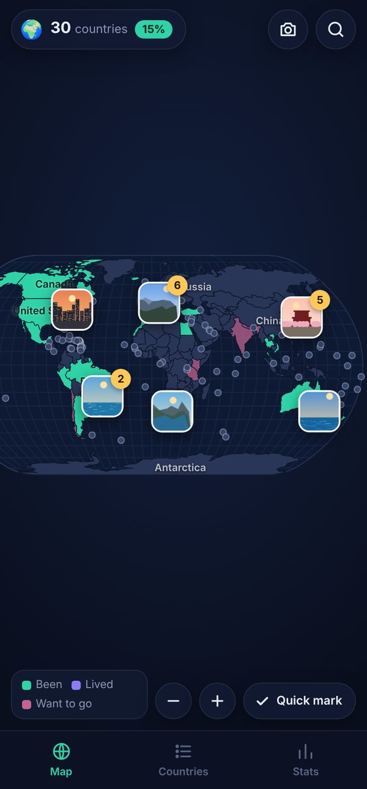
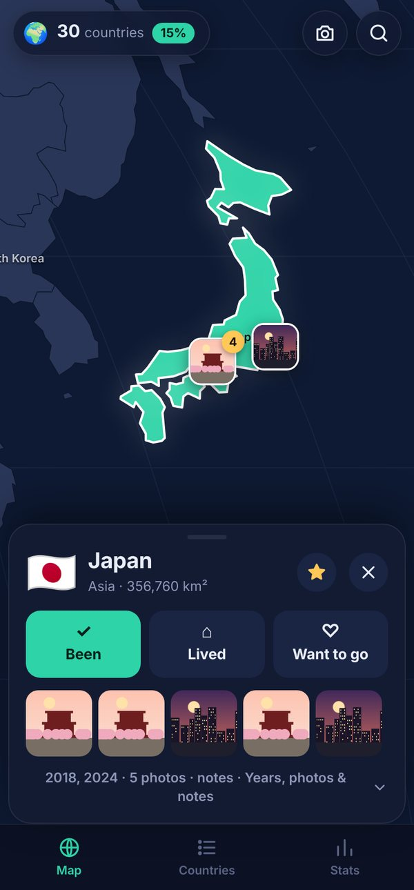
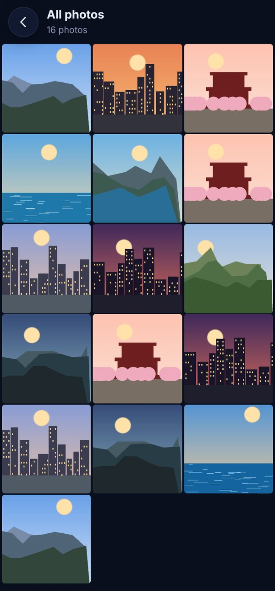
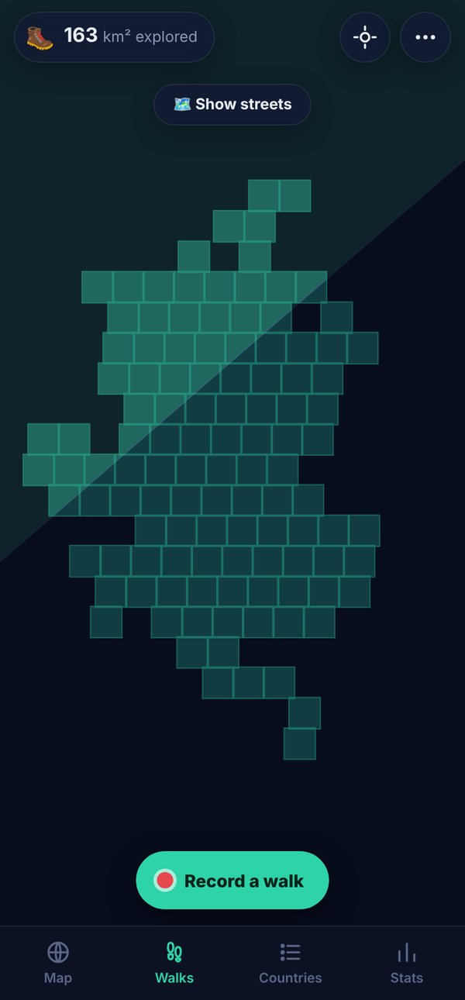
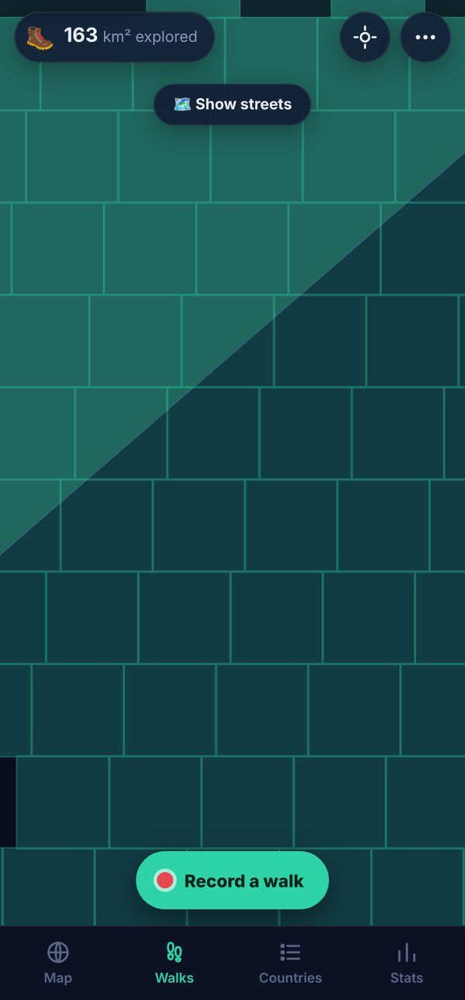
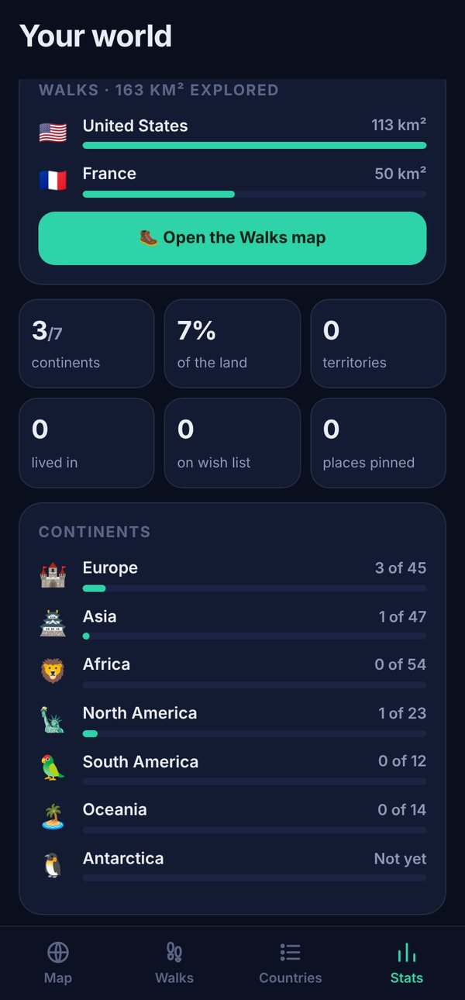

# Globetrot

Your own world travel map, which fills itself in. Globetrot quietly follows where you go and looks
at where your photos were taken, then lights up **every street you've been on, to the nearest
kilometre**, and marks the countries for you. You can also tap countries yourself, see **your
photos on the map where you took them**, keep a wish list and pin the places you loved. Free,
with no ads and no account. Everything it learns about you stays on your phone.

| The map | A country | Every country | Your stats | Badges |
|:---:|:---:|:---:|:---:|:---:|
|  |  |  |  |  |

| Your photos on the map | A country's photos | All your photos |
|:---:|:---:|:---:|
|  |  |  |

| Where you've walked | Up close | Km² explored per country |
|:---:|:---:|:---:|
|  |  |  |

## Install

`apk/Globetrot.apk` is ready to install:
[⬇ Globetrot.apk](https://github.com/OlRock8910/Unknown-projects/raw/main/globetrot/apk/Globetrot.apk).
Open it on your Android phone and allow "install unknown apps" for your browser or Files app
when asked. Every build is signed with the same key, so a newer APK installs over an older one
and keeps your map.

CI also builds it on every push (Actions, artifact **globetrot-apk**).

## What it does

**Colour in the world.** Tap a country and choose **Been**, **Lived** or **Want to go**. Been is
mint, lived is violet and the wish list is pink. Pinch to zoom, drag to move (with a fling), and
double-tap to zoom in. Country names appear as you zoom in. Countries too small to tap at world
zoom, such as Singapore, Malta and the Caribbean islands, get a dot until they're big enough.

**Your photos, where you took them.** Tap 📷 and **Find my photos**. Globetrot looks through the
photos on your phone and puts every one that has a location on the map, where it was taken. Photos
close together stack into one picture with a count, and they spread out as you zoom in. Tap one to
see it full screen and swipe through the rest. Each country's card shows the photos you took there.
After a scan Globetrot lists the countries your photos come from that aren't on your map yet, so
you can mark them all in one tap. When you open the app again it quietly picks up new photos.

- Photos are only read. They stay in your gallery and are never uploaded. **Hide** takes a photo
  off the map without touching your gallery.
- You can also **add photos** by hand from any country's card, or with the 📷 button. A photo with
  a location goes where it was taken; one without goes in the country you added it to.
- Android asks permission to see your photos the first time. Allow access to all photos and
  their locations, or Android removes the location from each photo. On Android 14 you can
  share just some photos.
- Your camera has to save the location. Most phones do this when location is turned on in the
  camera settings.

**Every street you've been on, to the nearest kilometre.** Going to Brazil once doesn't mean
you've seen Brazil. The **Walks** tab cuts the world into squares about 1 km across and lights up
only the ones you've actually been in. Everywhere else stays under a fog that clears as you explore.
A weekend wandering around Manhattan lights up the blocks you walked, not all of New York.

- **It maps where you go by itself.** The first time you open Globetrot it offers to follow you
  in the background and look at your photos. After that there's nothing to press. It keeps
  going with the app closed and the screen off, and it starts again by itself after the phone
  restarts. It uses the phone's low-power location (Wi-Fi and cell towers, about 100 m, which is
  plenty for 1 km squares), and lets the phone batch fixes, so the battery cost is small.
  **Sharper trails** switches to GPS if you'd rather.
- Android shows a quiet notification while Globetrot follows you (it requires one), with today's
  distance on foot and a **Pause** button.
- For it to carry on after a restart, allow location **All the time**. Globetrot points you to
  the setting. Some phones (Samsung, Xiaomi, Huawei, OnePlus) also stop background apps to save
  battery, so it offers to switch that off for Globetrot.
- When you turn up somewhere new, that country is **added to your map automatically** (with an
  Undo). New photos do the same each time you open the app. You can switch this off.
- Anything faster than walking or cycling pace (a car, a train, a flight) is left out of your
  trails, unless you choose to count it.
- **Import your history** to light up years of walks at once: your Google Maps Timeline (on the
  phone: Settings → Location → Location services → Timeline → Export Timeline data), Google
  Takeout location history, or GPX and KML files from Strava, Garmin, Komoot and other trackers.
  Big Takeout files are read a piece at a time. You can keep only the places you walked or
  cycled, or count everywhere you went.
- **Your photo locations count too**: the square around each photo lights up. You can switch
  that off in the Walks menu.
- **Show streets** to see the street map under the fog (from OpenStreetMap, drawn by CARTO). It's
  off until you switch it on, because it downloads map pictures. That's the only thing Globetrot
  uses the internet for. Without it, the Walks map draws the country outlines.
- The world map shows your walked squares as small white specks. Each country's card and the
  Stats tab say how many km² you've explored there, and two badges reward 100 km² and 1,000 km².
- It needs **precise** location. Approximate location is only good to a few km, which is too
  rough for 1 km squares.

**Quick mark.** Turn it on and every tap ticks a country off, or unticks it, without opening
anything. It's the fastest way to fill in your map the first time. Made a mistake? Every change
has an **Undo**.

**Years, places and notes.** Open a country for more: the years you went, notes, and a ★ for
your favourites. **Long-press anywhere on the map to pin a place** (Kyoto, that beach in Crete).
Pins show on the map with their names and are listed under their country.

**Every country.** The Countries tab lists all 237 countries and territories by continent with
a progress bar for each. Search ignores accents ("cote" finds Côte d'Ivoire), and filters show
just the places you've been, want to go, lived in or starred, or the ones you haven't been to yet.

**Your stats.**
- How many of the world's 195 countries you've seen (the 193 UN members plus Vatican City and
  Palestine). Territories like Greenland, Puerto Rico or Hong Kong count separately.
- Continents visited, how much of the world's land you've covered, and progress for each
  continent.
- A traveller rank, from 🏠 Homebody through ⛵ Voyager and ✈️ Globetrotter to 👑 Completionist.
- 18 badges: Four corners, All seven continents, Polar explorer, the G7, the Nordic set and more.
- Year by year: the flags of everywhere you went each year.

**Share your map.** Share a picture of your coloured-in map with your stats, or a line of text with
all your flags, to WhatsApp, Instagram, anywhere.


**Back up and restore.** Save a backup file to Drive or email it to yourself, then restore it on
any phone. You can also copy and paste the backup as text. The backup has your countries, years,
notes, pins and walked squares, but not your photos. On a new phone, **Find my photos** puts
your gallery back on the map.

## How it's built

A small web app (`web/`) in an Android WebView (`android/`), built into an APK without Gradle
by `build-apk.sh`. It asks for permission to read your photos, and their locations, only when you
tap **Find my photos**. `Photos.java` reads where each photo was taken (from the gallery index on
older Android, and from the photo itself on Android 10 and later, with the results cached so
later scans are quick). It also gives the map its thumbnails at `https://globetrot.local/`. In a
browser, added photos are kept in IndexedDB instead.

Your whereabouts are followed by `TrackService.java`, a foreground service (type `location`).
On Android 12+ it uses the framework's fused provider at balanced power with batching; on older
phones it uses network positioning plus the passive provider; GPS only for sharper trails. It
writes fixes to a file. `BootReceiver.java` starts it again after a reboot or update; without
"all the time" permission, Android won't give it locations from there, so it posts a tap-to-resume
notification instead. The page collects the fixes, joins points less than 1.5 km and 20 minutes
apart, and adds each 1 km square to a set that's saved as compact, delta-encoded text. `web/js/walks.js` draws the
Walks map in Web Mercator. The street map uses CARTO's dark tiles; offline, it uses the country
outlines from `world.js`, converted from the Natural Earth projection. Location history files are
read with one regular-expression pass that understands Timeline, Takeout, GPX and KML.

The map is Natural Earth's 1:50m country shapes (public domain). `tools/build-map.mjs` merges the
pieces a traveller counts as one country (Somaliland into Somalia, Northern Cyprus into Cyprus),
simplifies the outlines and projects them in advance into `web/js/world.js` (about 230 KB), so the
app needs no map library and no internet.

```sh
npm install && node tests/smoke.mjs    # browser test: tap, pinch, pin, search, list, stats, backup, photos, walks
./build-apk.sh                          # → build/Globetrot.apk
python3 make-icon.py                    # redraw the launcher icon
```

`build-apk.sh` needs `aapt2`, `javac`, `dalvik-exchange`, `zipalign` and `apksigner`. On Ubuntu:
`sudo apt-get install aapt dalvik-exchange zipalign apksigner default-jdk-headless zip`. It builds
against Android 14 (API 34). It uses the SDK's `android.jar` when `ANDROID_HOME` has one, and
otherwise downloads one once and checks it against a pinned SHA-256.
