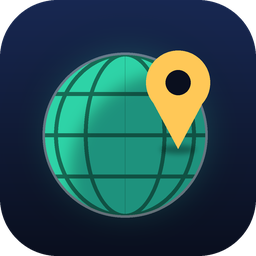
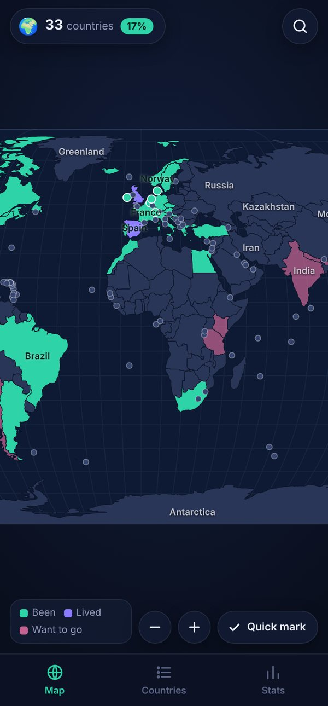
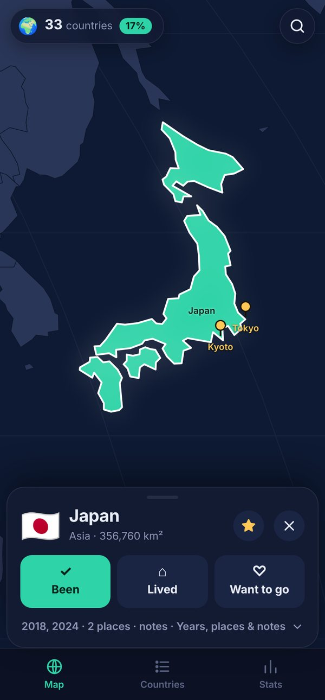
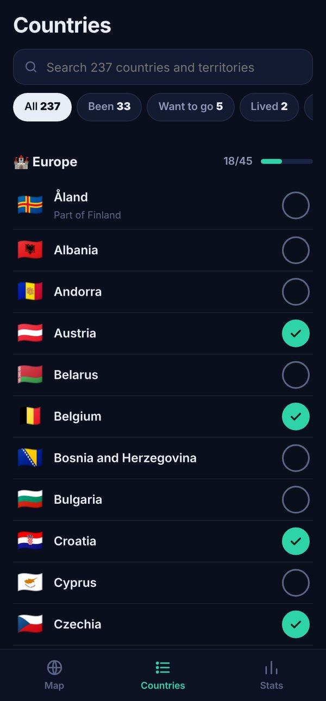
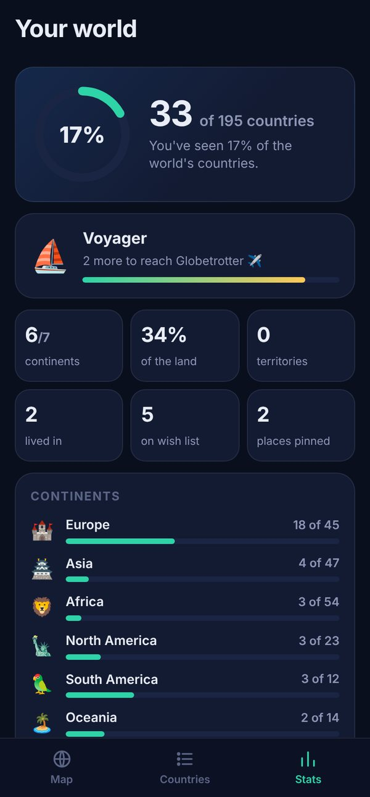
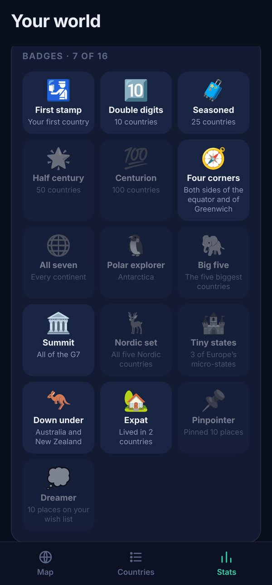
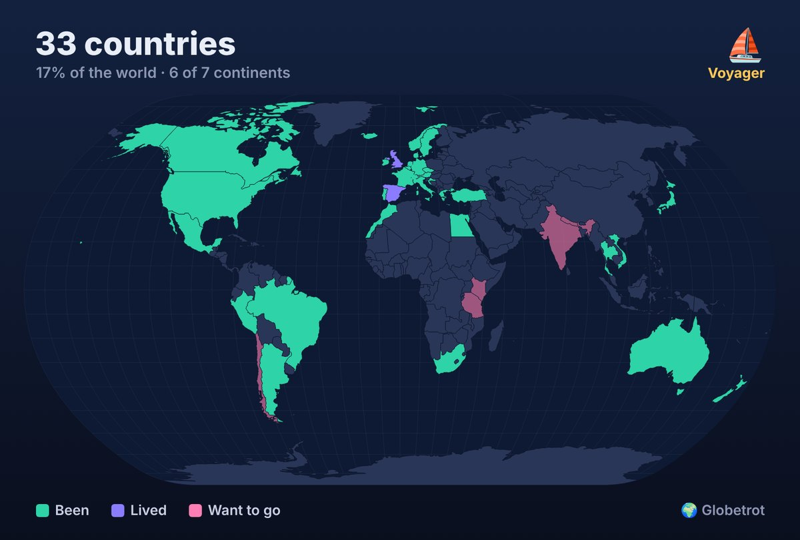

# Globetrot

Your own world travel map. Tap the countries you've been to and watch the world fill in. Keep a
wish list, pin the cities you loved, and see how much of the world you've seen. Free, with no
ads, no account and no internet. Everything stays on your phone.

| The map | A country | Every country | Your stats | Badges |
|:---:|:---:|:---:|:---:|:---:|
|  |  |  |  |  |

## Install

`apk/Globetrot.apk` is ready to install:
[⬇ Globetrot.apk](https://github.com/OlRock8910/Unknown-projects/raw/main/globetrot/apk/Globetrot.apk).
Open it on your Android phone and allow "install unknown apps" for your browser or Files app
when asked. Every build is signed with the same key, so a newer APK installs over an older one
and keeps your map.

CI also builds it on every push (Actions, artifact **globetrot-apk**).

## What it does

**Colour in the world.** Tap a country and choose **Been**, **Lived** or **Want to go**. Been is
mint, lived is violet and the wish list is pink. Pinch to zoom, drag to move (with a fling), and
double-tap to zoom in. Country names appear as you zoom in. Countries too small to tap at world
zoom, such as Singapore, Malta and the Caribbean islands, get a dot until they're big enough.

**Quick mark.** Turn it on and every tap ticks a country off, or unticks it, without opening
anything. It's the fastest way to fill in your map the first time. Made a mistake? Every change
has an **Undo**.

**Years, places and notes.** Open a country for more: the years you went, notes, and a ★ for
your favourites. **Long-press anywhere on the map to pin a place** (Kyoto, that beach in Crete).
Pins show on the map with their names and are listed under their country.

**Every country.** The Countries tab lists all 237 countries and territories by continent with
a progress bar for each. Search ignores accents ("cote" finds Côte d'Ivoire), and filters show
just the places you've been, want to go, lived in or starred, or the ones you haven't been to yet.

**Your stats.**
- How many of the world's 195 countries you've seen (the 193 UN members plus Vatican City and
  Palestine). Territories like Greenland, Puerto Rico or Hong Kong count separately.
- Continents visited, how much of the world's land you've covered, and progress for each
  continent.
- A traveller rank, from 🏠 Homebody through ⛵ Voyager and ✈️ Globetrotter to 👑 Completionist.
- 16 badges: Four corners, All seven continents, Polar explorer, the G7, the Nordic set and more.
- Year by year: the flags of everywhere you went each year.

**Share your map.** Share a picture of your coloured-in map with your stats, or a line of text with
all your flags, to WhatsApp, Instagram, anywhere.



**Back up and restore.** Save a backup file to Drive or email it to yourself, then restore it on
any phone. You can also copy and paste the backup as text.

## How it's built

A small web app (`web/`) in an Android WebView (`android/`), built into an APK without Gradle
by `build-apk.sh`. The only permission is vibration.

The map is Natural Earth's 1:50m country shapes (public domain). `tools/build-map.mjs` merges the
pieces a traveller counts as one country (Somaliland into Somalia, Northern Cyprus into Cyprus),
simplifies the outlines and projects them in advance into `web/js/world.js` (about 230 KB), so the
app needs no map library and no internet.

```sh
npm install && node tests/smoke.mjs    # browser test: tap, pinch, pin, search, list, stats, backup
./build-apk.sh                          # → build/Globetrot.apk
python3 make-icon.py                    # redraw the launcher icon
```

`build-apk.sh` needs `aapt2`, `javac`, `dalvik-exchange`, `zipalign` and `apksigner`. On Ubuntu:
`sudo apt-get install aapt dalvik-exchange zipalign apksigner android-sdk-platform-23 default-jdk-headless zip`.
