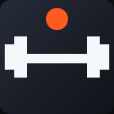
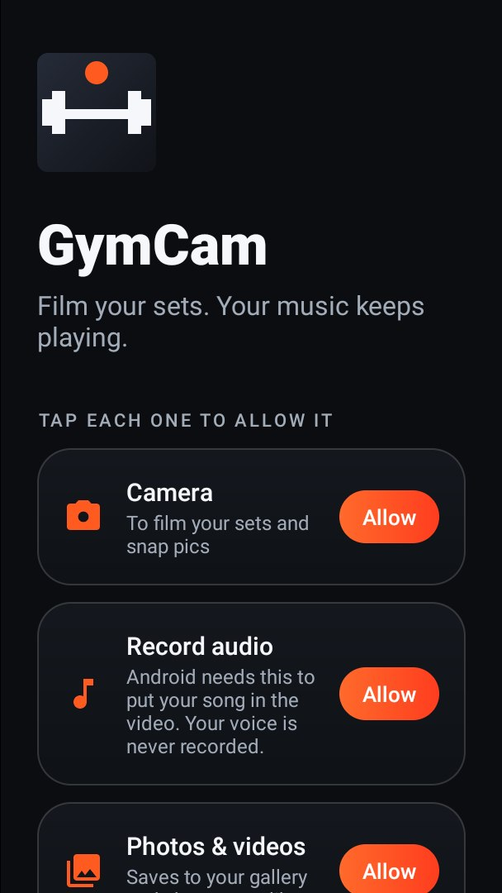
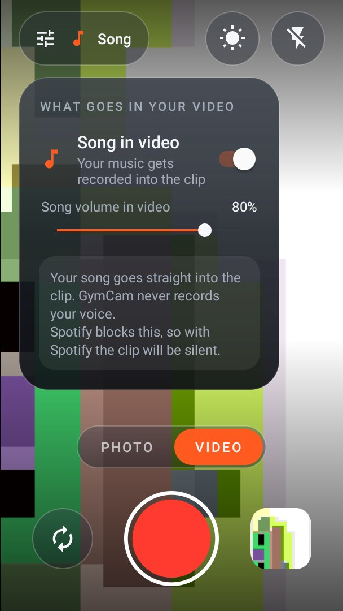
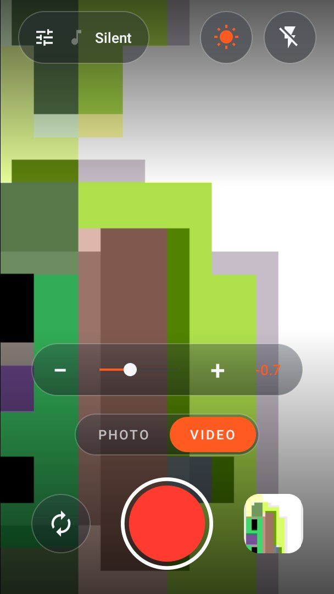
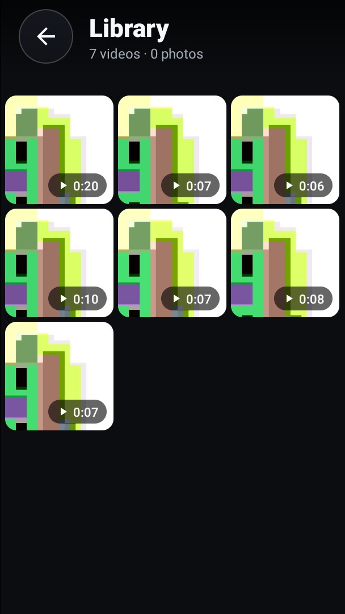

# GymCam

A camera for filming your sets **without your music stopping**. Most camera apps pause
Spotify or YouTube Music the moment you hit record. GymCam never asks for the audio, so your
music keeps playing while you film. Free, with no ads and no account.

| First launch | Song in video | Exposure | Library |
|:---:|:---:|:---:|:---:|
|  |  |  |  |

## Install

`apk/GymCam.apk` is ready to install. Copy it to your phone, open it, and allow
"install unknown apps" for your file manager or browser when asked. Every build is signed with
the same key, so a newer APK installs over an older one and keeps your settings.

CI also builds it on every push (Actions, artifact **GymCam-apk**). Needs Android 10 or newer.

## What it does

**Your music keeps playing.** GymCam records video without taking audio focus, which is what
makes other camera apps pause your music. Viewing clips in the library doesn't pause it either.

**Song in video (optional).** Tap the audio button at the top left and turn on *Song in
video*. The song you're playing is recorded straight into the clip, with its own volume slider.
Android asks once to "record your screen", because that's the only way an app can hear another
app's sound. GymCam keeps the song only: never the screen, and never your voice.

- With *Song in video* off, clips are silent. The microphone is never used.
- Some music apps, like Spotify, block other apps from recording them. Then the clip is silent
  and GymCam tells you.

**Exposure.** Tap the sun at the top right, then drag or tap − / + to make the picture darker or
brighter. Tap the number to reset. Your setting is remembered.

**Camera.** Up to 4K video (it drops to 1080p or 720p when the phone can't), max-quality photos,
photo and video modes, flash, front/back camera, pinch to zoom, tap to focus, and double-tap
to flip.

**Saved to your gallery.** Everything goes into `DCIM/GymCam`, so it shows in your phone's
gallery and Google Photos. The thumbnail at the bottom right opens GymCam's own library, where
you can play and share clips.

**Permissions up front.** The first screen asks for camera, audio, photos and (on Android 13+)
notifications. Tap each one to allow it. You can't continue until they're all allowed.

## Build

Kotlin, native Android, CameraX. JDK 17 and the Android SDK (API 35).

```bash
./gradlew assembleRelease
```

The APK lands in `app/build/outputs/apk/release/`. It's signed with `app/gymcam-sideload.jks`,
a sideload key kept in the repo so every build, local or CI, can update the last one.
