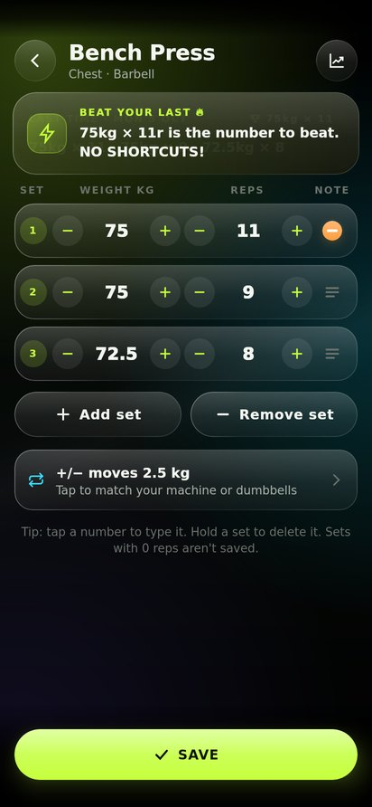
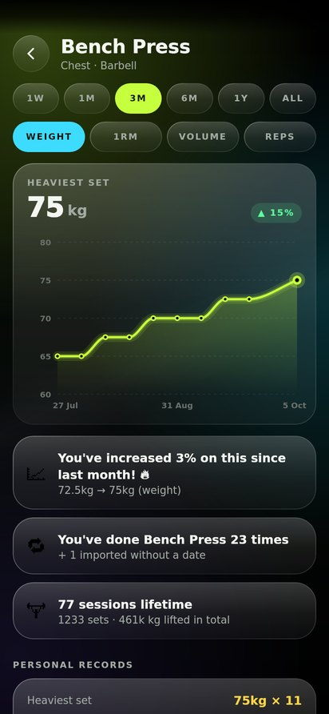
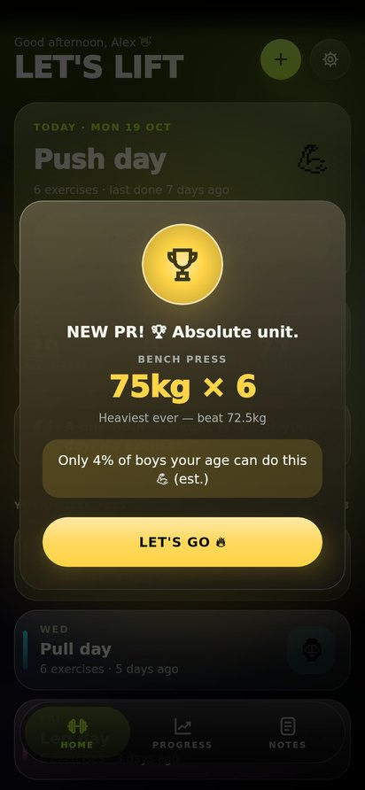
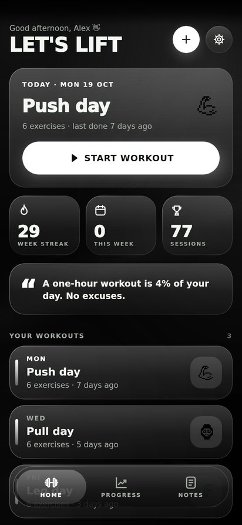
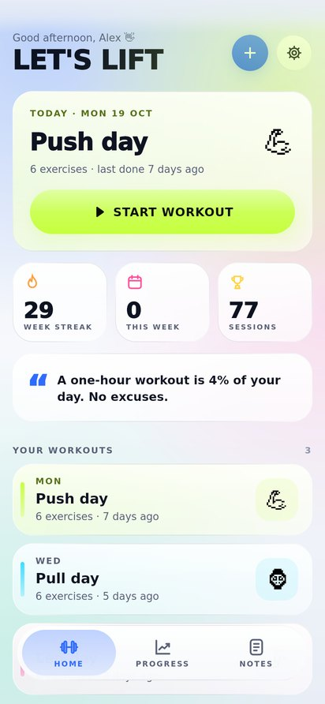
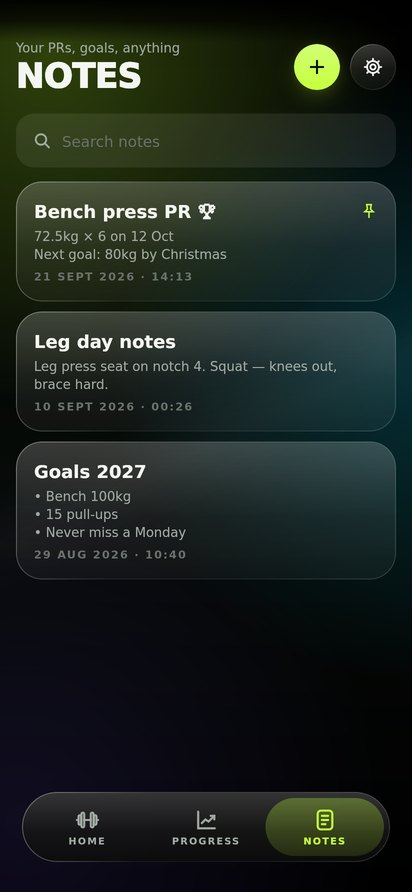
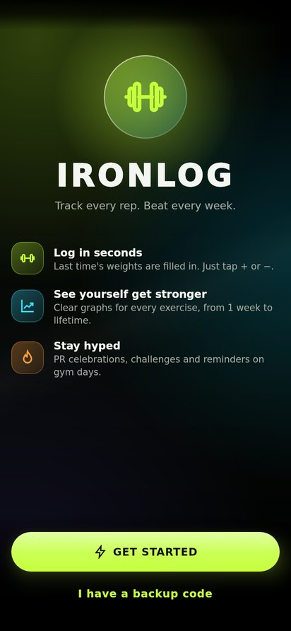

<h1 align="center">IronLog</h1>

<p align="center"><b>Track every rep. Beat every week.</b><br>
A free gym tracker for Android with a tinted black-glass look.</p>

<p align="center">
  <a href="https://github.com/OlRock8910/Unknown-projects/releases/download/ironlog-latest/IronLog.apk"></a>
  
  
</p>

| Home | Logging | Graphs | New PR |
|:---:|:---:|:---:|:---:|
|  |  |  |  |
| **Black mode** | **Light glass** | **Notes** | **Welcome** |
|  |  |  |  |

- ⚡ **Log in seconds.** Last time's weights are already filled in. Tap + or −.
- 📈 **See yourself get stronger.** Every exercise gets a graph, from 1 week to lifetime.
- 🏆 **Get hyped.** PR celebrations, "TRY 62.5KG!" challenges and reminders on gym days.
- 🎨 **Four looks.** Gym, Dark glass, Light glass and pure Black.
- 🔒 **Private.** No sounds, no ads, no account and no internet permission. Your data stays on your phone.

## Get the APK

Every change builds the app on GitHub Actions and publishes it to the
**ironlog-latest** release. Tap the download button above on your phone, or open
**[IronLog.apk](https://github.com/OlRock8910/Unknown-projects/releases/download/ironlog-latest/IronLog.apk)**.

1. Download `IronLog.apk` on your phone.
2. Open it. If Android says installs from this source aren't allowed, tap **Settings**
   and switch on **Allow from this source**, then go back and tap **Install**.
3. When the app asks, allow notifications if you want workout-day reminders.

New builds install over the old one and keep your data (every build is signed with
the same key, `app/ironlog-sideload.jks`).

## What's in it

- **Home**: today's workout with a Start button, your week of workouts (name on the
  left, emoji on the right, e.g. `Leg day 🦵`), streak and session counts, and a quote.
  The **+** (left of settings) makes a new workout, adds exercises to an existing one,
  adds a note, or imports past progress.
- **Workouts**: name, emoji, colour, the days you train it (these drive reminders) and
  its exercises, picked from over 150 built-in exercises with keyword search
  (`inc db`, `rdl`, `lat pull`…) or your own.
- **Logging**: last time's sets are filled in. **+/−** on weight and reps. Weight moves
  in steps that suit the kit (2.5 kg barbell and dumbbell, 5 kg machine, or anything
  you set). On machines the app also learns the step from the weights you enter. Add
  or remove sets freely, and skip any exercise. Each set has a note button (≡). Once a
  set has a note it shows as an orange dot, and the note carries over to next time
  until you delete it.
- **Motivation**: opening an exercise pops up a challenge such as *"Last week you got
  60kg × 12r. TRY 62.5KG! NO PAIN NO GAIN!"* (there are lots of these). Beat a record
  and you get a PR card with an estimate of how you compare with people your age. The
  estimate comes from published lifting standards, using your age, sex and bodyweight.
- **Progress**: lifetime sessions, this month, week streak and total lifted, plus a
  10-week activity chart. Every exercise gets a graph over 1W / 1M / 3M / 6M / 1Y / ALL
  for heaviest set, estimated 1RM, volume or reps. Touch the graph to read any point.
  You also get *"You've increased 10% since last month"*, how many times you've done
  it, your records, and the full history.
- **Notes**: free notes for PRs, goals or anything else. Notes can be pinned and searched.
- **Settings**: kg/lb, Gym / Dark / Light glass themes, 2 or 3 reminders a day at the
  times you choose, and switches for the pop-ups and comparisons.
- **Widgets**: *IronLog motivation* (quote + today's plan + this week) and *IronLog
  today* (what to train, big emoji).

## Backup code

Settings → Backup & restore copies all your data as one line of text starting with
`IRON1-`. Paste it into your notes or email it to yourself. On a new phone, paste it
back. The code is compressed and scrambled, and it ends in a checksum, so a code that
gets cut short is caught instead of half-restored. It has no password, so anyone with
the app and the code can open it.

## Adding past progress

Settings → Add past progress (or **+** → Add past progress) takes plain text, one
exercise per line:

```
Bench press 60kg x 12, 10, 8
Squat 5x5 @ 80kg
Pull ups 3x10

12/09/2026
Leg press 120 x 12
Lat pulldown 3 sets of 10 at 55
```

A date on its own line applies to the lines below it, until the next date or a line
that says `no date`. Lines **without a date** are kept in your history and count
towards your records, but they are left off every graph and trend. That way a pile of
old numbers can't look like a sudden jump in progress. Names that aren't in the
library become your own exercises. You see a preview before anything is added.

## Building

The app is a standard Gradle Android project (Kotlin, Jetpack Compose). From this
`ironlog/` folder:

```bash
./gradlew :app:assembleRelease      # app/build/outputs/apk/release/app-release.apk
./gradlew :app:testDebugUnitTest
```

It needs JDK 17 and the Android SDK.

### Checking it without the Android SDK

`tools/verify` is a separate Gradle project that only needs Maven Central. It compiles
the app's logic and Compose UI against Compose for Desktop, runs the same unit tests,
and renders every screen to PNG:

```bash
cd tools/verify
gradle test          # unit tests
gradle screenshots   # PNGs in tools/verify/build/screens/
```

Android-only code (activity, receivers, widgets) lives in `com.ironlog.android` and is
left out of that build.

## License

MIT. See [LICENSE](LICENSE).
