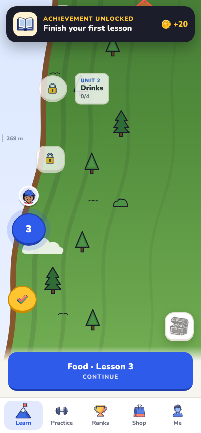
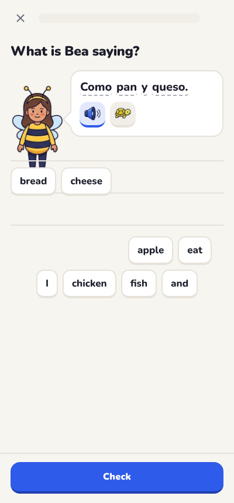
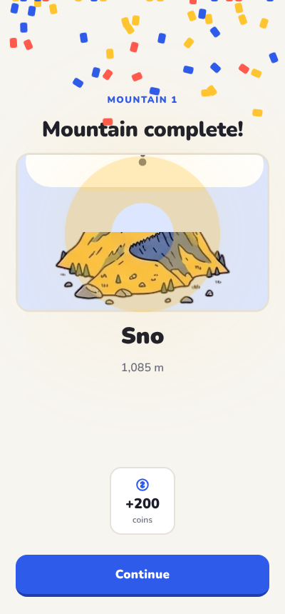
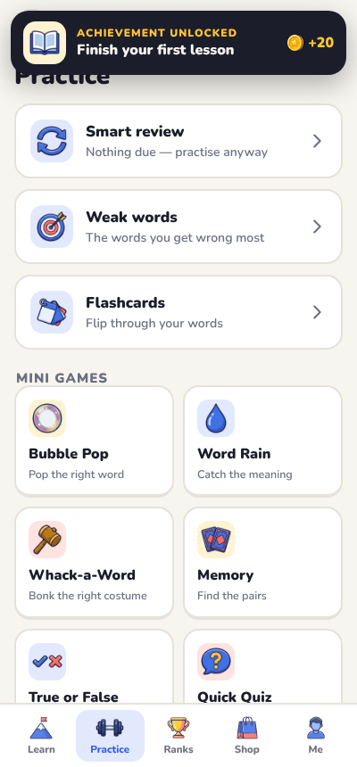
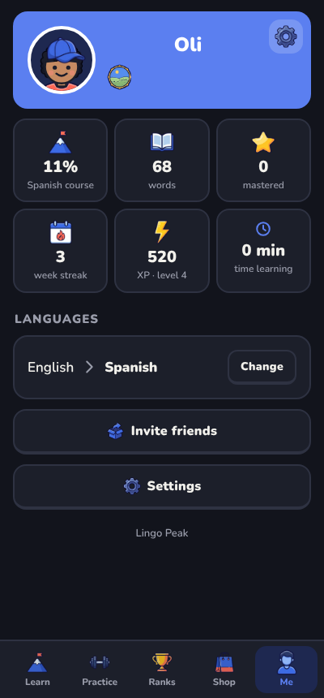

# Lingo Peak

**Climb ten mountains. Learn a language on the way up.**

Learn **English, Spanish, French, German or Portuguese**, from any one of the
others. The whole app talks to you in the language you speak. It's free, with
no ads, and works offline.

[⬇ Download LingoPeak.apk](https://github.com/OlRock8910/Unknown-projects/raw/main/lingopeak/apk/LingoPeak.apk)

| Learn | Lesson | Mountain complete | Practice | Me |
|:---:|:---:|:---:|:---:|:---:|
|  |  |  |  |  |

## What's in it

- **A big course:** 10 mountains (Snowdon up to Everest), 50 units,
  200 lessons, 600 words and 300 sentences in all five languages. That makes
  20 courses (every pair).
- **The side of the mountain:** your lessons are stops on a ridge climbing
  north-east, through grass, forest, rock, cliffs and snow, one mountain at a
  time.
- **Hidden mountains:** you don't know which mountain you're on until you reach
  the top. Then it's revealed with **Mountain complete!** and a badge goes on
  your banner, next to your username.
- **A costume cast:** Benny the banana, Shelly the shark, Rex the dinosaur and
  seven more. They say things in your new language for you to work out.
- **Your own character:** pick skin, hair, a hat, a top and trousers (five of
  each free, five more of each in the shop). Usernames are unique.
- **20 minutes a week:** a weekly goal instead of a daily one, with a weekly
  streak (1 week, 2 weeks…) and a home-screen widget on Android.
- **Coins and XP:** coins come from lessons, the weekly goal and mountains, and
  buy clothes, double XP and streak freezes. Nothing costs real money.
- **Leaderboards:** this week, learners of your language, all time, and
  friends (add them with a 6-letter code). See [docs/CLOUD.md](docs/CLOUD.md)
  to switch them on.
- **12 mini games:** Bubble Pop, Word Rain, Whack-a-Word, Memory, Survival,
  Six Hearts, a two-player duel and more.
- Light and dark mode, and the phone's own voices (Google's when installed)
  for pronunciation, with a slow button.

## How it teaches

It uses what memory research shows works best:

- **Spaced repetition.** Every word has a box from 0 to 5. Get it right and it
  comes back later (after 1, 3, 7, 16, then 35 days). Get it wrong and it comes
  back soon. **Smart review** shows the words that are due.
- **Retrieval practice.** You have to recall each word, not just reread it.
  You start by recognising a word, then recall it, then spell or type it
  yourself as it gets easier.
- **Sound with every word.** Each word comes with audio, plus a slow button.
- **Mixed reviews.** Reviews mix words from different units.
- **Real sentences.** The cast speak whole sentences for you to decode before
  you build your own.

## Pictures

The cast, badges and mountains are drawn with Gemini from the prompts in
[docs/ART.md](docs/ART.md). Each sheet holds 10 pictures on a magenta
background. `tools/cut-sheet.py` cuts a sheet into separate pictures with
see-through backgrounds, and `tools/list-art.py` tells the app which pictures
exist. Anything not drawn yet gets a simple placeholder.

## Building

```sh
npm install && node tests/smoke.mjs   # browser test: course data, all languages, lessons, games
./build-apk.sh                        # → build/LingoPeak.apk (needs aapt2, javac, dx, zipalign, apksigner)
UPLOAD_KS=… UPLOAD_KS_PASS=… ./build-aab.sh   # → build-aab/LingoPeak.aab for Google Play (needs bundletool too)
node tools/store-assets.mjs           # → docs/play/: Play icon, feature graphic, screenshots
node tools/promo.mjs promo            # → tall TikTok/Reels clips of the app
```

Google Play: the bundle uses the package name `com.olrock.lingopeak` (the
sideload APK keeps `com.olrock.adjetivos`) and is signed with a private
upload key that is **not** in this repository. Store text, data-safety answers
and the privacy policy are in [`docs/play/`](docs/play/LISTING.md).

The app is plain HTML/CSS/JS in `web/`, wrapped in a tiny Android app in
`android/` that provides speech, vibration, sharing and the widget.

| File | What it does |
|---|---|
| `web/js/course/*.js` | The course content, one file per mountain |
| `web/js/course.js` | Builds the course for a language pair; spaced repetition; progress |
| `web/js/lesson.js` | Exercises (including speaking and gap fill), lessons and practice |
| `web/js/rewards.js` | Daily chest, streak rewards and achievements |
| `web/js/games.js` | The mini games |
| `web/js/app.js`, `onboarding.js` | Screens |
| `web/js/cloud.js` | Leaderboards, friends and online backup (Supabase) |
| `web/js/i18n.js` | Every piece of app text in all five languages |

Text and code: MIT. Font: Nunito (SIL Open Font License, `web/fonts/OFL.txt`).
