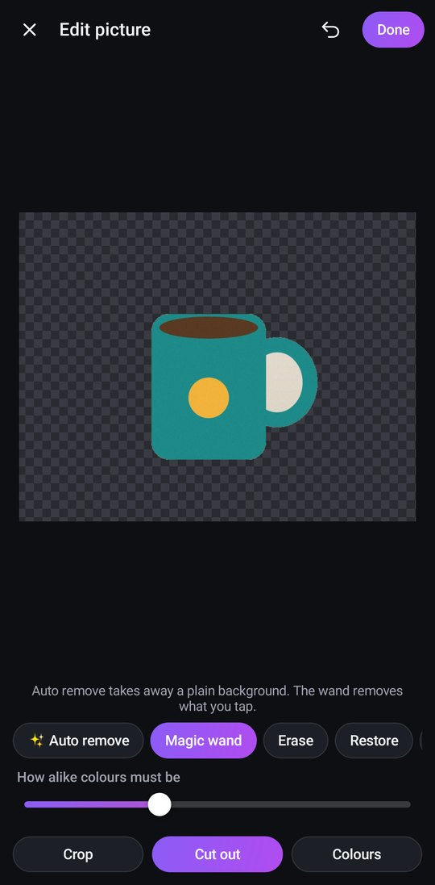
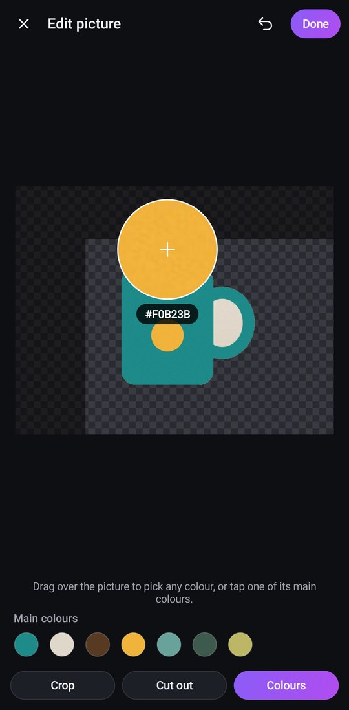
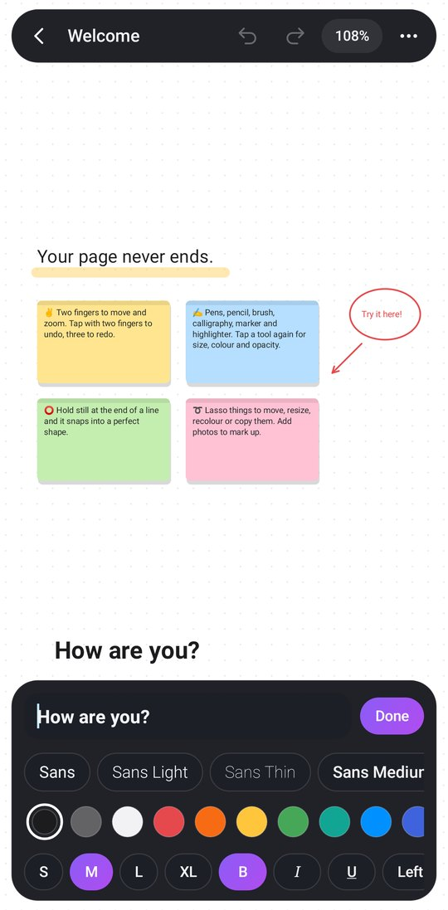
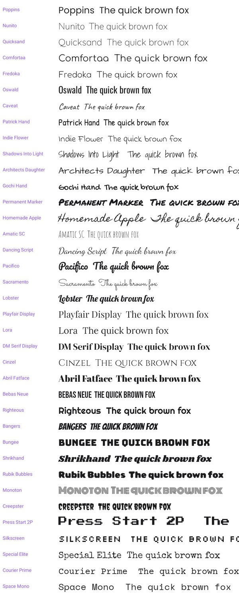

# Sketchnote

Endless paper for sketches, notes and ideas on Android phones and tablets. An infinite
canvas you can zoom in and out of forever, with pressure-sensitive pens, sticky notes, text,
shapes and photos to mark up. Free, with no ads, no account, no internet, and no permissions.

| Your boards | Sketch | Tools | Lasso |
|:---:|:---:|:---:|:---:|
|  |  |  |  |

| Cut out a background | Pick colours from a photo |
|:---:|:---:|
|  |  |

## Install

`apk/Sketchnote.apk` is ready to install. Copy it to the phone or tablet, open it, and allow
"install unknown apps" for your file manager or browser when asked. Every build is signed with
the same key, so a newer APK installs over an older one and keeps your boards.

CI also builds it on every push (Actions, artifact **Sketchnote-apk**).

## What it does

**An infinite page.** Pinch to zoom from 2% to 4000%, drag with two fingers to move, and fling
to glide. Tap the zoom number to jump between 100% and seeing everything. Dots, grid, ruled or
blank paper in white, cream, grey, slate, black or blueprint.

**Ink that feels real.** Every stroke is shaped by pen pressure (or, with a finger, by speed),
smoothed as you draw and tapered at the ends:

| Tool | Feel |
| --- | --- |
| Pen | Smooth fountain-pen line that swells with pressure |
| Pencil | Grainy graphite with paper tooth |
| Brush | Ink brush with long, pointed tapers |
| Calligraphy | Flat nib: thick down-strokes, hairline cross-strokes |
| Marker | Even, bold line |
| Highlighter | See-through, chisel-ended |

Each tool remembers its own size, opacity and colour (13-colour palette, recent colours, and a
full colour picker).

**Hold to snap.** Draw a wobbly line, circle, triangle, box or polygon and hold still at the end:
it snaps into a clean shape. Lines snap level, upright and to 45°. The Shapes tool also drags
out lines, arrows, rectangles, ellipses, triangles and diamonds, filled or not.

**Notes and text.** Sticky notes in eight colours and plain text. Typing happens in a bar at
the bottom of the screen while the note itself updates live on the page (which scrolls to keep
it above the keyboard). The bar has 47 fonts, each shown in itself (37 bundled: handwriting,
script, classic serif, display and typewriter styles, plus the phone's own), colours, four
sizes, **bold**, *italic*, underline and left / centre / right alignment. Tap a note to edit it,
drag to move it.

| Text bar | Fonts |
|:---:|:---:|
|  |  |

**Layers.** Select anything and tap the layers button to bring it to the front, forward one,
back one, or behind everything, so drawings and notes can sit behind pictures. (To pick up
something hidden behind a picture, draw a lasso loop round it.)

**Annotate photos.** Add any picture from your gallery or files and draw on top of it. Every
picture opens in the picture editor first (and again any time: select it and tap the pencil):

- **Crop**, with free, original, square, 4:3, 3:4 and 16:9 frames, plus rotate and flip.
- **Cut out** the background. *Auto remove* takes away a plain background (a wall, paper, a
  table, the sky) that touches the edges, the *magic wand* removes whatever area you tap, and
  *Erase* / *Restore* brushes tidy up the edges. Cut-outs keep their see-through background on
  the page, trimmed to what is left (stray specks are dropped), so the selection box hugs the
  subject. This works by colour, on the device, so it is best with fairly plain backgrounds.
- **Colours**: drag the magnifier over the picture to pick any colour, or tap one of its main
  colours. Picked colours go on your pen and into your colours.

**Eyedropper.** In any tool's colour panel, *Pick a colour from the page* lets you drag a
magnifier over anything on the board (ink, notes, photos) and take that exact colour.

**Pick things up.** Press and hold on anything you have put down (a picture, a note, a drawing),
with any tool, to pick it up; keep holding and drag to move it. Tap a picked-up picture or note
again to edit it (the picture editor or the text editor). Tap empty paper to put it down and you
are back on the tool you were using. When drawing with a pen, a quick finger tap does the same.

**Lasso.** Loop round anything (or tap one thing) to move it, recolour, duplicate or delete
it. Dots on every corner and side resize it: corners keep its shape, sides stretch it one way
(text gets wider or narrower and rewraps instead of stretching). Put two fingers on the
selection and twist to turn it (pinch to resize at the same time); it snaps straight at 0°,
90°, 180° and 270°. Two fingers anywhere else still move and zoom the page.

**Eraser.** Precise (rubs out just what it touches, splitting lines) or whole strokes.

**Made for pens and tablets.** The first time a stylus touches the screen, fingers switch to
moving the page and your palm is ignored while you write, even if it landed first. The pen's
side button or eraser end erases with any tool. Low-latency pen input, mouse-wheel zoom and
Ctrl+Z / Ctrl+Shift+Z on keyboards. Works in portrait, landscape and split screen.

**Gestures.** Two-finger tap = undo, three-finger tap = redo.

**Share.** Export a board as a high-resolution PNG or a vector PDF, or save the image to the
gallery (Pictures/Sketchnote). Boards save themselves as you go, on the device only.

## Building

Normal build (needs JDK 17+ and the Android SDK, which Android Studio installs):

```
cd sketchnote
./gradlew testDebugUnitTest assembleRelease
# -> app/build/outputs/apk/release/app-release.apk
```

No Android SDK, or can't reach Google's servers? `tools/build-apk-local.sh [--test]` builds the
same sources with just `javac`, `aapt`, `dx` and `apksigner` from Debian/Ubuntu packages (see
the script header). That is how `apk/Sketchnote.apk` was produced.

### Layout

```
app/src/main/java/com/sketchnote/app/
  ink/      stroke outlines, shape recognition, geometry: pure Java, unit-tested
  img/      background removal, magic wand, brushes, colour picking: pure Java, unit-tested
  model/    boards, items, undo history and the file format: pure Java, unit-tested
  render/   drawing ink, notes, pictures and paper onto a Canvas (GPU display list on Android 10+)
  ui/       the canvas view (touch, stylus, gestures) and the toolbar widgets
  MainActivity    the board list
  BoardActivity   the editor
  ImageEditActivity  the picture editor (crop, cut out, colours)
```

The app was first called Infinink. Its package (`com.infinink.app`) and signing key keep that
name on purpose: changing either would stop updates installing over the first builds.

Boards are stored in the app's private storage in a compact binary format (`model/BoardCodec`),
written to a temporary file and renamed into place so a crash never leaves a broken board.

## License

MIT, like the rest of this repository. The bundled fonts in `app/src/main/assets/fonts` are
from Google Fonts under the SIL Open Font License 1.1 (Permanent Marker, Homemade Apple and
Special Elite under Apache 2.0); each font's licence is in `assets/fonts/licenses`.
