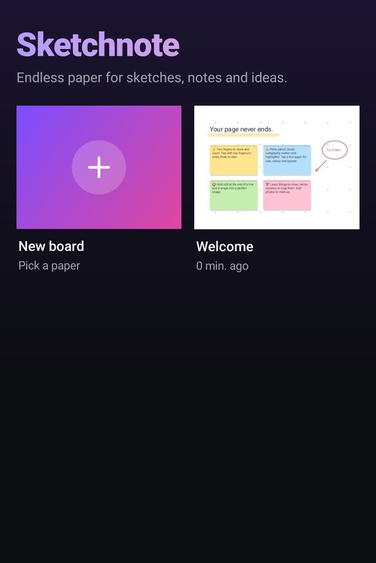
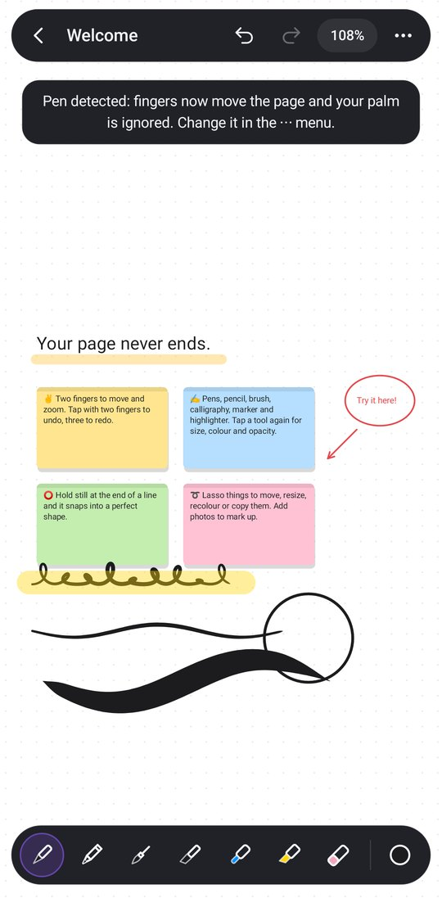
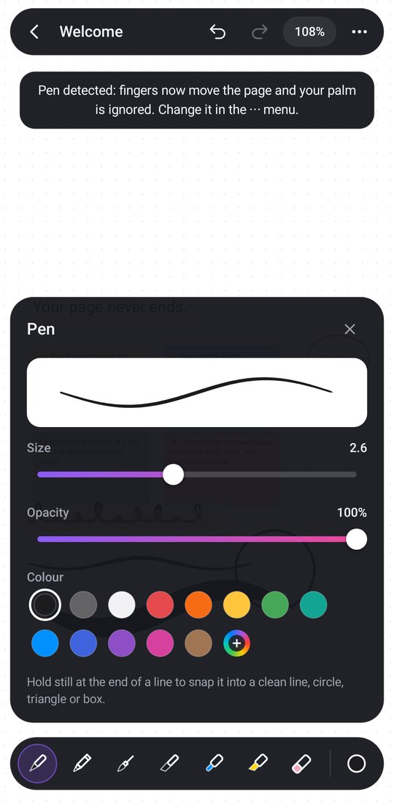
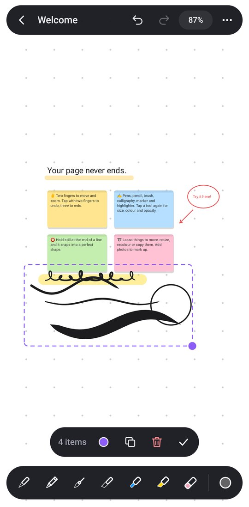

# Sketchnote

Endless paper for sketches, notes and ideas on Android phones and tablets. An infinite
canvas you can zoom in and out of forever, with pressure-sensitive pens, sticky notes, text,
shapes and photos to mark up. Free, with no ads, no account, no internet, and no permissions.

| Your boards | Sketch | Tools | Lasso |
|:---:|:---:|:---:|:---:|
|  |  |  |  |

## Install

`apk/Sketchnote.apk` is ready to install. Copy it to the phone or tablet, open it, and allow
"install unknown apps" for your file manager or browser when asked. Every build is signed with
the same key, so a newer APK installs over an older one and keeps your boards.

CI also builds it on every push (Actions, artifact **Sketchnote-apk**).

## What it does

**An infinite page.** Pinch to zoom from 2% to 4000%, drag with two fingers to move, and fling
to glide. Tap the zoom number to jump between 100% and seeing everything. Dots, grid, ruled or
blank paper in white, cream, grey, slate, black or blueprint.

**Ink that feels real.** Every stroke is shaped by pen pressure (or, with a finger, by speed),
smoothed as you draw and tapered at the ends:

| Tool | Feel |
| --- | --- |
| Pen | Smooth fountain-pen line that swells with pressure |
| Pencil | Grainy graphite with paper tooth |
| Brush | Ink brush with long, pointed tapers |
| Calligraphy | Flat nib: thick down-strokes, hairline cross-strokes |
| Marker | Even, bold line |
| Highlighter | See-through, chisel-ended |

Each tool remembers its own size, opacity and colour (13-colour palette, recent colours, and a
full colour picker).

**Hold to snap.** Draw a wobbly line, circle, triangle, box or polygon and hold still at the end:
it snaps into a clean shape. Lines snap level, upright and to 45°. The Shapes tool also drags
out lines, arrows, rectangles, ellipses, triangles and diamonds, filled or not.

**Notes and text.** Sticky notes in eight colours and plain text, in four sizes. Tap to edit,
drag to move.

**Annotate photos.** Add any picture from your gallery or files and draw on top of it.

**Lasso.** Loop round anything (or tap one thing) to move it, resize it from the corner,
recolour, duplicate or delete it.

**Eraser.** Precise (rubs out just what it touches, splitting lines) or whole strokes.

**Made for pens and tablets.** The first time a stylus touches the screen, fingers switch to
moving the page and your palm is ignored while you write, even if it landed first. The pen's
side button or eraser end erases with any tool. Low-latency pen input, mouse-wheel zoom and
Ctrl+Z / Ctrl+Shift+Z on keyboards. Works in portrait, landscape and split screen.

**Gestures.** Two-finger tap = undo, three-finger tap = redo.

**Share.** Export a board as a high-resolution PNG or a vector PDF, or save the image to the
gallery (Pictures/Sketchnote). Boards save themselves as you go, on the device only.

## Building

Normal build (needs JDK 17+ and the Android SDK, which Android Studio installs):

```
cd sketchnote
./gradlew testDebugUnitTest assembleRelease
# -> app/build/outputs/apk/release/app-release.apk
```

No Android SDK, or can't reach Google's servers? `tools/build-apk-local.sh [--test]` builds the
same sources with just `javac`, `aapt`, `dx` and `apksigner` from Debian/Ubuntu packages (see
the script header). That is how `apk/Sketchnote.apk` was produced.

### Layout

```
app/src/main/java/com/sketchnote/app/
  ink/      stroke outlines, shape recognition, geometry: pure Java, unit-tested
  model/    boards, items, undo history and the file format: pure Java, unit-tested
  render/   drawing ink, notes, pictures and paper onto a Canvas (GPU display list on Android 10+)
  ui/       the canvas view (touch, stylus, gestures) and the toolbar widgets
  MainActivity    the board list
  BoardActivity   the editor
```

The app was first called Infinink. Its package (`com.infinink.app`) and signing key keep that
name on purpose: changing either would stop updates installing over the first builds.

Boards are stored in the app's private storage in a compact binary format (`model/BoardCodec`),
written to a temporary file and renamed into place so a crash never leaves a broken board.

## License

MIT, like the rest of this repository.
