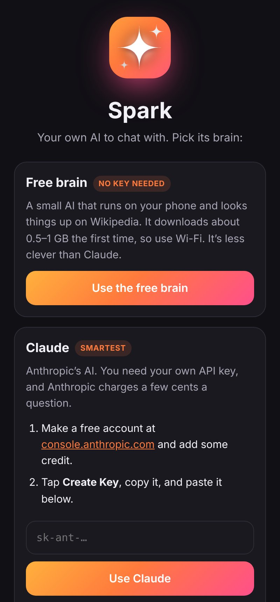
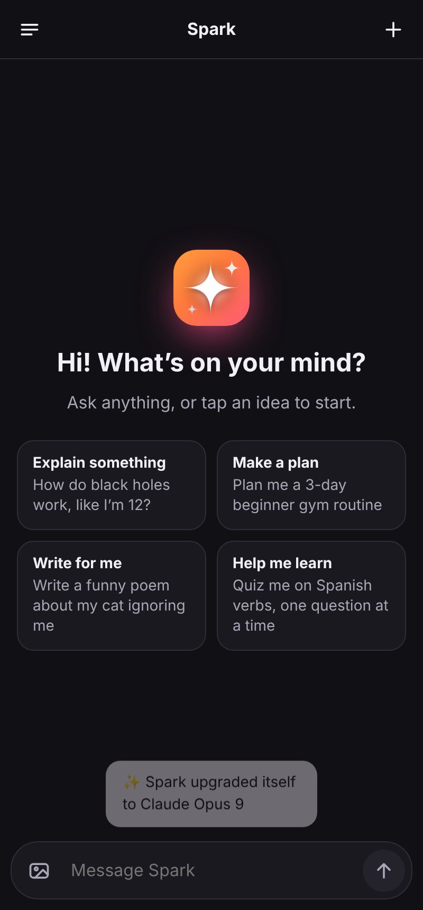
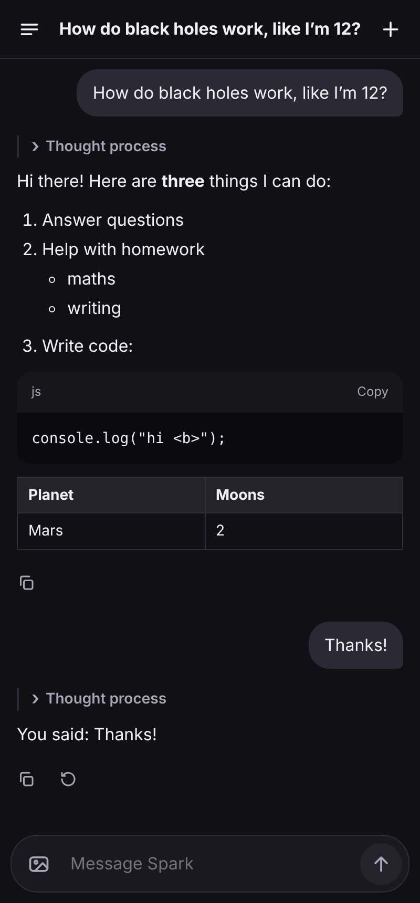
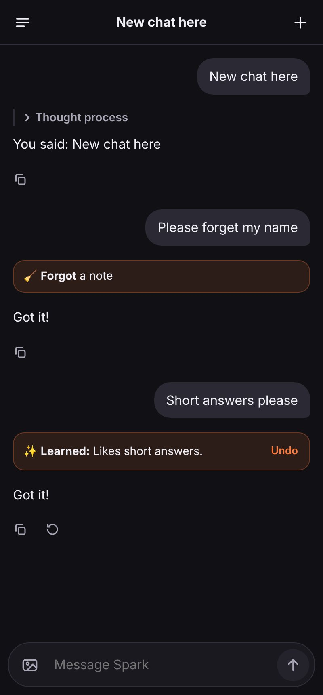
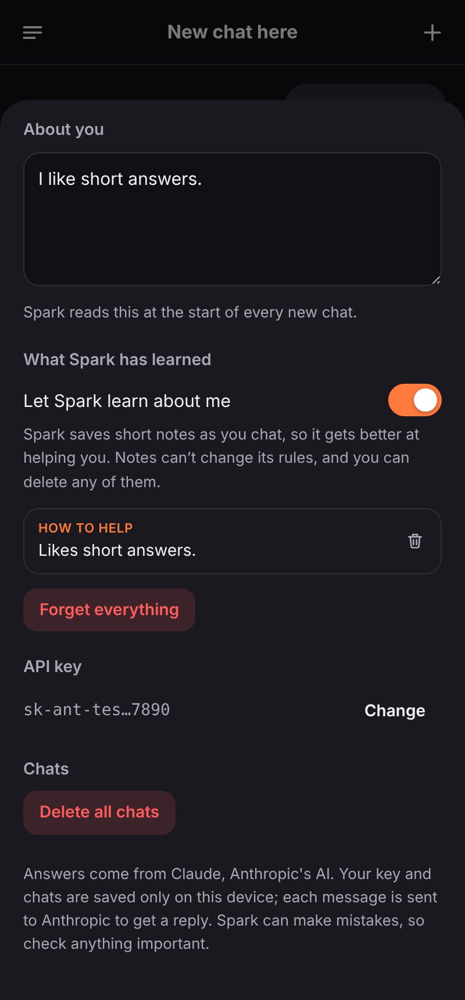
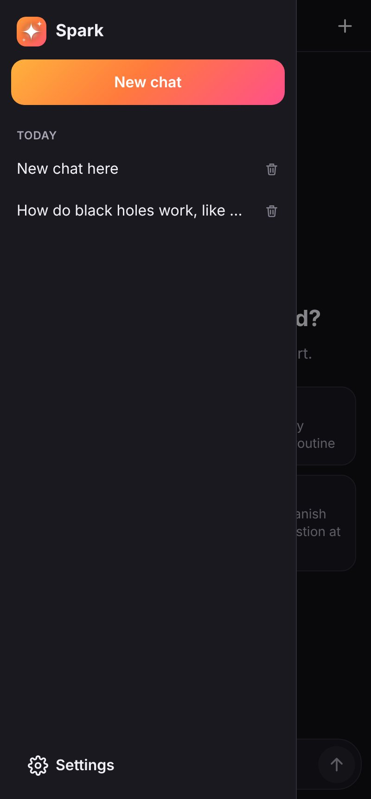

<p align="center">
  
</p>

<p align="center">
  <a href="https://olrock8910.github.io/Unknown-projects/spark/"></a>
  <a href="https://github.com/OlRock8910/Unknown-projects/raw/main/spark/apk/Spark.apk"></a>
  
</p>

# Spark ✨

**Your own AI to chat with, and it gets better the more you use it.** Ask
it anything, get help with homework, plans, writing or code, or show it a
photo. Spark runs on **Claude**, Anthropic's AI.

| **Get started** | **Ask anything** | **Answers** | **It learns** | **Its memory** | **Your chats** |
|:---:|:---:|:---:|:---:|:---:|:---:|
|  |  |  |  |  |  |

- **Replies stream in as they're written**, with lists, tables and code
  blocks laid out properly (code has a copy button).
- **Photos:** tap the picture button to add up to 4 photos to a message, then
  ask about them ("what's this plant?", "help with question 3").
- **Thinking:** Claude thinks before it answers. Tap **Thought process** to
  see a summary of how it got there. In **Settings**, pick **Quick**,
  **Balanced** or **Deep** thinking.
- **About you:** tell Spark about yourself and how you like answers
  ("I'm 15, keep it short") and it remembers in every new chat.
- **Chats are saved** on your phone. Open the menu to go back to one, or
  delete it.
- **Stop** a reply partway through, **copy** any answer, or tap **↻** for a
  different answer.

## How Spark upgrades itself (safely)

**It learns about you.** As you chat, Spark saves short notes about you
("Name is Sam, loves football") and how you like answers ("likes short
answers"), and reads them at the start of every new chat. Each time it
saves one, a **✨ Learned** card appears in the chat with an **Undo**
button. Ask it to forget something and it will.

**It moves to newer Claude models.** About twice a day Spark checks
Anthropic's list of models. When a newer Claude Opus comes out, new chats
use it (**Settings › Spark's brain**). If the new model doesn't work with
Spark, it goes straight back to the one that does and never tries that
model again.

**Why it won't go off the rails:**

- **Its rules are fixed.** The instructions that make Spark *Spark* are
  written into the app. Its notes are given to it as information about
  you, labelled as something that can't change its rules, so a note can
  never rewrite how it behaves.
- **You can see everything it learns.** Every note is listed in
  **Settings › What Spark has learned**, where you can delete any of them,
  wipe the lot, or switch learning off.
- **Its memory is small and limited.** It's up to 40 short notes, it's told
  not to save private things like health, addresses or passwords, and the
  app refuses notes that look like passwords or keys.
- **It can't change its own code or its own "brain."** Spark's values come
  from Claude, which Anthropic trains to be honest and safe. Spark can
  only choose which official Claude model to use, and only ones Anthropic
  publishes. It never edits the app itself.

## You need an Anthropic API key

Spark talks to Claude directly with your own key, so there's no Spark
account or subscription. Anthropic charges for what you use: a typical
question costs a few cents, and long chats, photos and Deep thinking cost
more. You can set a monthly spending limit in the console.

1. Go to **[console.anthropic.com](https://console.anthropic.com/settings/keys)**
   and sign up.
2. Add some credit under **Billing**. A few pounds or dollars lasts a long time.
3. Under **API keys**, tap **Create Key** and copy it.
4. Open Spark and paste the key in. Spark checks the key (for free) before
   saving it.

**Privacy:** your key and your chats are saved only on your device. Each
message, along with the chat so far, goes straight from your phone to
Anthropic to get a reply. Nothing passes through any other server. Anyone
who can use your phone can use your key, so you can delete it at
console.anthropic.com at any time and make a new one.

## Install the Android app

1. On your phone, tap the green **Download Spark.apk** button at the top of
   this page (or open [`apk/Spark.apk`](apk/Spark.apk) and tap **Download**).
2. Open the downloaded file. If Android asks, allow your browser or file
   manager to **install unknown apps**.
3. Tap **Install**, then open **Spark**.

Or use it in any browser at
**https://olrock8910.github.io/Unknown-projects/spark/**. On a phone, tap
**Add to Home screen** in your browser's menu to keep it like an app.

## How it's built

```
web/              The whole app: plain HTML, CSS and JavaScript, no build step
  js/app.js         Screens, chats, memory, upgrades, and talking to Claude
  js/markdown.js    Lays out Claude's replies (escaped, so replies can't inject HTML)
  js/store.js       Saves settings and chats on the device
  js/vendor/        Anthropic's official TypeScript SDK, bundled into one file by vendor.mjs
android/          A WebView wrapper with a photo picker and the back button
build-apk.sh      Builds and signs the APK without Gradle
make-icon.py      Draws the icon
tests/smoke.mjs   Uses the app in a real browser against a stand-in Claude API
```

To run it on a computer, serve `web/` (ES modules don't load from
`file://`), for example `npx serve web`, and open the address it prints.

**Talking to Claude.** Each reply is one streaming request to the Messages
API from the browser, using Anthropic's SDK with
`dangerouslyAllowBrowser: true` (fine here, because it's your own key on
your own device). The requests:

- use Claude's newest Opus model with adaptive thinking, summarised thinking
  shown in the app, and the effort level from Settings;
- turn on server-side fallbacks (`fallbacks: "default"`): if Claude's safety
  checks decline a harmless message by mistake, Anthropic answers it with a
  backup model instead of failing, and Spark notes it under the reply;
- give Claude two tools, `save_memory` and `forget_memory`. Their input is
  checked before anything is saved; a malformed call goes back to Claude
  as an error instead;
- cache the conversation, so long chats cost less;
- send each chat's history back exactly as it came, thinking blocks
  included. Every chat keeps the system prompt, tools and model it started
  with, so changing **About you**, the memory or the model only affects
  new chats. (Notes saved partway through a chat are already in that chat
  as tool calls.)

If Claude declines a message, Spark takes it out of the chat and puts it back
in the box to reword.

### Updating the bundled SDK

```bash
npm install --no-package-lock
npm run vendor      # rebuilds web/js/vendor/anthropic.js from @anthropic-ai/sdk
npm test            # the browser test
```

### Building the APK

```bash
sudo apt-get install aapt dalvik-exchange zipalign apksigner android-sdk-platform-23 default-jdk-headless zip
./build-apk.sh             # → build/Spark.apk
cp build/Spark.apk apk/    # update the downloadable copy
```

`.github/workflows/spark.yml` runs the browser test and builds the APK
(uploaded as the `spark-apk` artifact) whenever `spark/` changes, and
`adjetivos-pages.yml` publishes `web/` as the website alongside Adjetivos.

Every build is signed with `android/spark-sideload.jks`, which is committed
on purpose and whose password (`sparkapp`) is public, so new versions install
over old ones and keep your chats. It is only for sideloading; the Play
Store would need a private key.

## License

MIT, like the rest of this repository: see [LICENSE](../LICENSE). The bundled
Anthropic SDK is MIT licensed too: see
[`web/js/vendor/anthropic-LICENSE.txt`](web/js/vendor/anthropic-LICENSE.txt).
